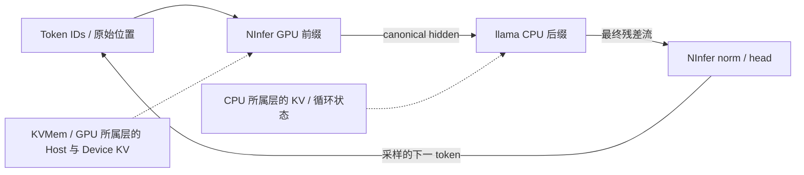

# NInfer 与 llama 混合层段及异步页流水补充调研

> 状态：**现行**（源码调查与研究方案；第三后端及混合执行实验待实施）
> 更新日期：2026-10-25
> 适用范围：NInfer 作为 QLH 新的本地执行后端，NInfer／llama.cpp 固定层段组合，以及 KVMem／Async Page Pipeline 的适配与验证。既有吞吐归因、优化账本和其他论文统一引用[前一份调研](异构推理吞吐瓶颈与外部技术调研-2026-10-24.md)；设备实测与验收数字继续归入 [R6](重构产品验收-R6-2026-10-19.md)。

## 1. 结论与推荐路线

**值得实现 NInfer GPU 层段与 llama.cpp CPU 层段的混合原型。** 固定层归属时，两个后端交换相同语义的层间残差流，各自保管所属层的注意力 KV／循环状态。这条路线允许 `.ninfer` 与 GGUF 两种制品共同完成一次前向；工程前提是共同权重来源、边界表示对齐、真实的部分装载与执行接口，以及跨执行器的请求状态提交。

KVMem 可以随后管理 GPU 层段的历史、驻留页和换入换出，作为内存能力独立接入。引入新引擎与引入 KVMem 分别验证，能区分低位内核、层放置、历史复用与分页策略的贡献。KVMem 的多后端管理提供公共生命周期与预算合同，原生 payload 仍由各后端编码。[K1–K3]

推荐先实现 **NInfer GPU 前缀 → llama CPU 后缀 → GPU head** 的离线数值与计时原型，再接 QLH 产品入口；head 放 CPU 作为对照。CPU 后缀开始时可以来自现有远端 worker，随后扩展同机多个执行器。先关闭 MTP／投机与有损选页，逐项叠加研究；收益由相同模型、质量预算和工作负载下的对照决定。

下图为同机目标原型；CPU 执行器也可以放在另一物理设备上，边界合同保持一致。



## 2. 六个仓库各自提供什么

| 来源／固定版本 | 已有能力与可取用部分 | 选型边界 |
| --- | --- | --- |
| Neroued NInfer `64d10fbf` | 当前动态参数架构；逐层 residual、DFlash 层后 feature、明确的参数绑定／内存／执行分层 | 当前单 GPU、目标 sm_120a，v3 `.ninfer`；新 API 与旧 fork 分别适配 [N1–N4] |
| KVMem `767e4ee2` | 公共内存事务／Host 分层；其 NInfer 补丁树已有连续 GPU 层 pipeline，支持指定 StageLayers | 多后端分进程；多 GPU 路径要求同 compute capability，CPU 层段 ABI 待补 [K1–K3] |
| Fusion `9a5a9204` | 现有完整引擎派生线和多量化实现，作为旧分支候选；机制与交付形态沿用[前一份调查](异构推理吞吐瓶颈与外部技术调研-2026-10-24.md#42-kvmemfusion-与-bonsai从中应拿走什么) | 固定实际源码／二进制／制品来源；此次补查重点是其派生 Async 和 ternary 路线 |
| Async 项目层 `f7e5c191`／引擎层 `a4f32e26` | KV ring、后台 D2H、当前所选页 H2D、pin／reservation／event；可提取流水调度 | 两分支与发布 tag 身份不同；超池 attention 使用驻留选择集 [A1–A5] |
| ring `d6aa55a9` | 环式 KV 池、驻留 mask、作者真实长上下文及负结果；有 RTX 3060 作者记录 | 当前 decode-no-restore 与 Async restore 的策略不同，按各自语义对照 [R1–R2] |
| ternary-5060ti `104af690` | 旧架构的 72 文件补丁态，PTQ1／PQ2、Hadamard 输入旋转、复用 projection basis | 依赖另一个 Bonsai engine-main 基线；与当前 Neroued v3 动态 API 分属不同架构，pack／制品共同验收 [T1–T2] |

**基座按目标 GPU、目标模型和可复建的完整源码树选择。** 当前 Neroued 上游只注册 Qwen3.5 dense／MoE 与 Qwen4Exp；README 的目标是 Linux x86-64／单 RTX 5090，根 CMake 固定 sm_120a。KVMem／Fusion 系其他平台的能力按其独立分支验证。先验证目标卡所需原生算子与制品，再改层段；整模参考可以在足容量环境建立，或由独立逐层数学 oracle 支撑。[N1、K1]

首个数学参考选有明确官方形状／配方的 Qwen3.5-family Dense Text，覆盖真实 GDN＋full attention，关闭 Vision／投机／Graph／有损选页。当前上游的 GDN state planner 要求非零 GDN 几何，局部全 attention 段需要补“本地零 GDN 层”路径。现有 QLH 的小尺寸模型能否复用，以其格式／原生 Op 的尺寸准入实测决定；直接新增 Qwen2／任意 GGUF 支持属于另一项模型适配。[N1–N4]

### 2.1 NInfer 可直接定位的改造入口

| 源码符号 | 实际语义 | 层段改造 |
| --- | --- | --- |
| `execution::TextContext::run_layers(Tensor& x, Phase, Tap&)` | x 是 BF16 完整 residual，每层 mixer 与 FFN 的 residual add 都在本层完成 | 增加 `[begin,end)`，保留全局 layer→attention／GDN compact index 映射，接收／返回 canonical x |
| `DFlashFeatureSink::capture_layer` | 在 `post_mixer` 后拷贝所选层的 x | 借用输出语义及拷贝机制，解开 DFlash 专属 buffer／选层合同 |
| `ordinary_decode_batch(...hidden,...logits)` 与 prefill hidden | 内部仍执行 embedding／全部层／head；这里 hidden 是 final norm 后的输出 | 将 embedding、层段、final norm、head 拆成明确入口，新增外部 residual 输入 |
| `loading::bind_text`、`plan_load`、`materialize_model` | 当前绑定 embedding／head／final norm 与全部 Text blocks | 从加载计划就筛选所属层及组件，再分配 weights／KV／GDN／workspace；只缩短 forward 循环仍占整模资源 |

上述入口来自当前 Neroued 树 [N2–N4]。KVMem 的 GPU pipeline 可以借鉴 stage 归属及传递设计，其旧 `Program` 和新上游符号按分支分别改造。

选择性装载按实际 encoded object／parent 的 binding closure 取并集；共享物理 parent 的逻辑 projection 可能需要一起保留。层范围 manifest、实际上传字节和显存回执共同证明分段效果，报价采用可物化的对象集合。[N3]

## 3. 同一请求怎样跨两种引擎执行

### 3.1 数学边界：组合层函数，保留原始残差语义

设 embedding 为 `E`，完整模型有 `L` 层，切点为 `k`，最终归一化与输出投影为 `N/H`。固定层段执行：

```text
h0 = E(token_ids)
hk = F[k-1](...F[0](h0, state0)..., state[k-1])     # NInfer GPU
hL = F[L-1](...F[k](hk, state[k])..., state[L-1])   # llama CPU
logits = H(N(hL))                                  # 唯一 head 所有者
```

每一层使用同一请求的 token、mask、原始位置和已提交前缀状态。固定归属下，每层仅访问本层 KV 或循环状态；跨引擎边界传递 `hk/hL` 即可。这个分解由层函数的组合给出，GPU／CPU 和文件格式决定函数的实现方式。

| 边界合同 | 原型要求与检查方式 |
| --- | --- |
| 数值边界 | 残差流处于层块结束、最终 `output_norm` 之前；一个 norm／residual 只执行一次，比较切点实际数组 |
| 张量表示 | 首先连续 CPU f32，明确 `[batch,token,hidden]` 或 `[token,hidden]` 及其序列映射；随后单独实验 pinned／共享内存／f16 |
| 逻辑位置 | 原始 position 与序列身份；区分页地址、RoPE 位置、循环更新顺序；多模态另传位置分量 |
| 模型语义 | 共同 checkpoint、tokenizer、模板与配置；保留全局层号、full-attention／GDN 类型及残差／归一化规则 |
| 状态生命周期 | session／attempt／step、已提交 frontier、执行历史、后端 state schema；reset／重试／取消／重放覆盖全部执行器 |
| 制品来源 | 原始权重摘要 → 转换配方／工具 revision → 各制品摘要 → 层范围／组件；GPU 与 CPU 量化分别登记 |

QLH 的 `src/llama_engine.py:LlamaCppEngine._keep_head_upstream` 与 `scripts/model_tools/keep_head_shim/qlh_keep_head.c:qlh_extract_hidden` 在 `layer_inp(lid == n_layer)` 提取最终 norm 之前的残差。`forward_layers_to_hidden/from_hidden` 和 `KeepHeadUpstream.forward_hidden_to_hidden` 是可复用边界；shim 的 hook 覆盖与具体架构补丁一起核验。

### 3.2 同源量化、表示变换与模型选择

不同后端可以使用不同量化。先用同 checkpoint 的较高精度制品分离接口误差，再用预先固定的混合量化 oracle 衡量内核、层段和传输误差；相对原模型的任务质量另测。两份不同量化权重形成明确的混合量化模型，浮点逐位相同还需要运算顺序和精度条件。

位宽与物理布局分别记录。上游 `q4_g64_fp16` 的 row-split／scale／padding 与 GGUF `Q4_K` 各有编码；ternary 已读内核中 PQ2 G128 的 codes＋FP16 scale 为 `(32+2)*8/128=2.125 bit/weight`，PTQ1 为 `(24+2+2)*8/128=1.75`，尚未计对齐及混精度参数。README 的“1.72 bit”与某一制品的整体平均体积需要另核，不能直接替代这些布局字节数。[N6、T1–T2]

转换中的 Q/K 排列、缩放、norm folding、通道重排或旋转逐项分类：层内闭合且后端已恢复语义的变换可以保留；穿过切点的变换需要导出 canonical hidden，或让相邻段遵循同一表示配方。如果切点两侧分别是 `h'=R1 h`、`h''=R2 h`，且 `R1` 可逆，适配为 `h''=R2 R1^-1 h'`；记录额外成本。有损边界变换进入质量实验。

模型名称与 hidden 宽度只提供结构线索。结构变更、独立微调或蒸馏后的模型按新目标模型分别生成两种制品，再研究混合。转换来源校验可从 `src/model_supply_sources.py:_proof/_convert/ensure_registered_sources` 扩展。

已核 upstream 的 `grouped_absmax` 转换只进行分组 absmax、scale 舍入、round／clamp／padding；QKV／gate 行排列属于局部布局。ternary 的 `folded_activation/ternary_dispatch` 另分配 rotated activation，再送 projection，已读路径保留原 residual x。这两条路线为 canonical residual ABI 提供具体依据。ternary 的完整 packer／部分旧 Variant 尚待补齐；关闭 `NINFER_TERNARY_HADAMARD` 会使 folded 权重的输入基底错误，只能用于性能拆解。[N5、T2]

Qwen3.5 Text 使用 offset RMSNorm，即 `(1+w) * x / sqrt(mean(x*x)+eps)`，而 GDN 内部还有 plain norm／gate。转换时明确 GGUF／NInfer 是否已经补过 `+1`，在 canonical 边界比较实际 norm 输入与输出。部分 NVFP4 配方还从 quantized checkpoint 取 norm／GDN controls 等非矩阵参数，来源证明覆盖这些参数。[N2、N5]

### 3.3 固定层归属与动态迁移分开设计

首个原型固定 `NInfer:[0,k)`、`llama:[k,L)`，各层状态随引擎驻留。GPU head 回收最终 hidden，单独完成 norm／projection／采样；CPU head 对照减少一次 hidden 回传，但改变输出投影的计算位置。现行规划 `src/qlh_core/planning/capacity.py:solve_pipeline_capacity` 以 `end == layer_budget` 将 LM head 分给尾段，尾段直接返回 token；GPU 前缀保留 head 的方案需同步扩展组件规划、报价与制品所有权。`segment_mode="head"` 表示前缀段，其含义与 LM head 组件分别处理。

后续改变切点或将同一层迁到另一引擎，需要跨后端状态转换，或从可信前缀重放恢复。Qwen3.5 的 GDN／卷积状态参与 checkpoint 和恢复；attention KV 分页之外的状态由引擎保存。[K2–K3]

stage 先实现 eager，拥有稳定的输入／输出和位置／状态 selector buffer，经 H2D → 层段执行 → D2H／事件交接。NInfer 原生 BF16 与边界 f32 显式转换，BF16／FP16 分别处理；arena 临时 residual 的拷贝完成后才允许 reset。之后按范围、dtype、实际 batch／token extent 和资源 profile 捕获 Graph，指针或布局变化时 update／recapture。[N2、N4]

## 4. QLH 具体需要改什么

审查基线为 QLH `addb05199f37df1ea4fbd96d75cb1d6a1c47de2f`。以下均为待实施改造，当前事实由列出符号确认。

| 改造面 | 当前源码事实 | 最小实现方向 |
| --- | --- | --- |
| 引擎登记 | `src/qlh_core/contracts/engines.py:ENGINE_REGISTRY` 有 llama／PyTorch 本地路径，也有 island／external API 整请求路径；`src/koakuma_engine.py:select_backend` 选一个节点后端 | 新增 NInfer family、runtime kind／native ABI／架构／精度／层段能力，按实际构建和 GPU 准入 |
| 部分装载 | `src/inference_service/engine_host.py` 层段加载有 prepare／materialize／commit／finalize；llama 用 precut GGUF | NInfer 真正只装载／分配所属层及组件，提供 token／hidden 输入、canonical hidden 输出、head 入口 |
| 制品供给 | `src/model_supply_assets.py:validate_supply_manifest` 收 GGUF／safetensors；`src/model_supply.py:ModelSupplyCoordinator._sources/_execute` 分两种来源与构建 | 增加 NInfer descriptor／转换证明／层选择／缓存键／清单，消除把非 llama 路径一律当 safetensors 的分支 |
| worker 身份 | `src/worker_prepare_contract.py:validate_identity` 接受 llama_cpp／gguf 和 pytorch／safetensors | 版本化新增 NInfer 配对与边界语义；prepare／stage／cleanup 绑定同一制品和 load_spec |
| 同机双执行器 | `src/qlh_core/contracts/execution.py:ExecutionPlan.__post_init__` 要求至少两段、node_id 唯一；`bootstrap/execution.py:ExecutionApplication.freeze` 每节点冻结一个 assignment | 分离物理 node 与 executor／resource domain；一节点可有多个局部上下文，连接及故障仍归属物理节点 |
| 容量报价 | `src/model_supply_runtime_capacity.py:project_supply_capacity_nodes` 限定 llama／PyTorch；RuntimeLoadSpec 有 components／device／KV／batch／context | 按实际逐层字节、workspace、Graph、KV／GDN、pinned staging 报价；同机 llama 权重与 NInfer Host KV 共用 RAM 总账 |
| dispatch／head | `bootstrap/execution.py:NativePorts.prefix/stage/head` 使用当前 host 和 CPU f32；head 有 PyTorch 专用转换；容量规划当前将 LM head 分给尾段 | 增加 NInfer buffer／head 适配，扩展 head 组件规划、报价和供给；唯一 embedding／norm／head 所有者，明确 GPU↔CPU 拷贝同步 |
| 状态回收 | `contracts/execution.py:StageIdentity/StageReceipt` 绑定部署／assignment／请求／step；`NativePorts.cleanup` 清理已使用 worker 和前缀 | 同机执行器有 incarnation／frontier／取消 drain；所有段到达 step 才发布结果，异常后恢复共同提交前缀 |

`RuntimeLoadSpec` 位于 `src/qlh_core/contracts/load.py`，可承接具体策略；其当前 `kv_dtype` 取 float16／float32／bfloat16／artifact，`kv_policy` 取 dynamic／preallocated／disabled。`src/qlh_core/planning/load_spec.py:assignment_load_spec` 的 GGUF 生成策略固定 CPU／preallocated，其他 materialization 仍限定 safetensors 两类；新增 NInfer 需同步扩展策略生成。原生压缩 KV 格式、工作集／分页策略显式版本化；当前 schema_version=1 且 `from_dict` 严格比较字段集合，协议升级包含旧 peer 准入。权重量化与 KV 格式分别记录，family／runtime_kind／artifact／实际 receipt 一致。Android 继续运行受支持的 llama 段，NInfer 在匹配 CUDA 节点部署。

同机原型可用独立 NInfer 子进程与现有 keep-head 进程，再测共享内存 IPC。产品先支持一 GPU 段＋一 CPU 段，保持统一部署权威；重复注册虚拟物理节点会掩盖 RAM 共享、断线和设备竞争。

执行器数、物理节点数和 backend 参与分别显示与计量；同机两执行器共同完成一次请求时保留同一物理节点归属。

## 5. KVMem 与 Async Page Pipeline 的适配

### 5.1 公共内存合同与层状态所有权

`memory_contract.hpp` 以 `BackendIdentity` 记录引擎、revision、模型和 state schema；`PayloadLayout.format/version/planes` 描述后端原生字节及层号。`NativeKvPayload` 保留量化 scale／padding，跨后端共享的是管理接口。固定层归属的混合执行因此优先实现各后端自己的内存适配器，边界只交换残差流。[K2–K3]

**接入目标为请求与页视图的两级提交。** 当前 `LinearExecutor.run` 顺序执行各段、核验 receipt 后发布 token，`NativePorts.restore_prefix` 通过清空各段并按原批次重放恢复；KVMem 页事务尚未接入 QLH。目标是在每个执行器自己的 engine-safe boundary 发布准备好的页视图，同时让全部层达到共同已执行前缀后发布请求结果。`MemoryStamp` 分开记录 session incarnation、history_revision、view_version、逻辑 frontier 与 execution_history；`ViewBlock.compact_start` 只作 attention 地址，RoPE 使用原始位置。已采样而尚未 forward 的 token 与已执行 frontier 分开。[K1–K2]

`MemoryTransfer` 要求 prepare 先保留全部目的空间，spill 完成前保留源页，restore 完成后才 publish；abort 在释放 buffer 前 drain／cancel。Host 存储用 `HostKvLease` 延长有效字节及其配额所有权，排队的 `HostKvSource` 可延迟取得读租约。将这些规则移植到 NInfer 段，可以避免取消后仍有 DMA 写入被复用内存。[K2–K3]

GDN／卷积状态、workspace 与模型权重仍归各执行器；`raw_kv_payload_layout` 只登记实际 attention 层。跨后端同层迁移要另定义 state 转换或重放。开启 GPU 检索选页后，各层实际 attention 视图、执行历史和质量策略一起进入实验身份，精确驻留／前缀复用保留为独立对照。

### 5.2 Async 的实际数据流

核验引擎分支 `a4f32e26` 的 `program/storage/context.cpp`、KV store、CUDA stream／event、decode 与 attention kernel。**搬运对象为 KV 页**，一逻辑页覆盖 64 token 的 attention K／V planes，量化格式另带 scale；权重和 MoE 专家使用各自机制。[A1–A3]

| 路径 | 已实现机制与符号 | 对混合原型的意义 |
| --- | --- | --- |
| 后台 D2H | `demote_kv_pages_to_host` 保护 sink，提交通常每批 8 页；compute stream 记录 source-ready，transfer stream 等待后搬运、记录 completion | 可提取写回调度与 buffer／reservation 所有权，隐藏部分 spill 时间 |
| 延迟回收 | `PendingDemoteRing` 保留逻辑页 handle、Host reservation 与 inflight 会计；`retire_pending_demote` 等完成、发布 Host 后才释放 Device | 页的计划腾出量与实际可分配量分别计数，复用前确认真实完成 |
| 当前需求 H2D | `restore_kv_pages_from_host` 对当前 preferred 页排队恢复；批末 `cudaStreamSynchronize`，decode 的 mapping／restore 完成后才启动计算 | 可以合并逐页等待；attention 对本次使用页面仍有先到达条件 |
| 稀疏驻留视图 | `install_resident_selection` 为当前驻留页安装 bitmap；kernel 对未选中页跳过 tile 或设 logits 为负无穷 | 超池语义按 sparse attention 验收，页面身份与被省略信息一起记录 |
| 缺页行为 | 缺 Host 副本时跳过；无 Device free run 时停止 restore；新增 token 的硬容量不足另有 `ContextCacheExhausted` | 补 explicit required-set／incomplete 结果，避免将成功 HTTP 等同于召回齐全 |

attention kernel 已有在线 softmax 和 split statistics 合并，其覆盖范围是当前 mask 允许的驻留页。**全历史 exact streaming attention** 可复用这组统计量，继续增加跨 Host stage-in 批次的持久累加、全 required-set 覆盖与最终 normalize；公式见 §6.2。现有 split 归约提供局部工程基础。[A2–A3]

ring 当前 HEAD 另有取舍：ordinary／MTP／DFlash decode 调用 `ensure_sequence_kv_mapped(..., restore_preferred=false)`，prefill 仍可恢复。这个 decode-no-restore 版本按其稀疏窗口语义单独建对照。[R1]

### 5.3 正确性工程还需要哪些补足

Async 已有源页 pin／Host reservation／完成事件／析构 drain 等机制。取用时继续核查这些具体条件：[A1–A4]

- `PendingDemote` 在复制完成前保留来源，发布失败保留 Device 副本。当前同一 transfer stream 共用最后 record 的 fence，完成判定可保守推迟较早 batch 的回收；可研究 per-batch event。
- 默认 pinned 路径使用 `cudaHostAllocPortable`；`NINFER_HOST_PAGEABLE` 可切 pageable。实际异步能力按运行配置与 timeline 验收。
- resident bitmap 预分配以保持 capture 指针稳定，后续扩容／clear 的分支需要 Graph update／recapture 合同；mapping／restore 位于 Graph launch 之前。
- runtime 安装的取消 probe 按值捕获 unit 开始时的布尔快照。执行期间新取消的可见性、异常清 probe、per-request batch drain 与超时属于待补项；CUDA 中已提交复制的完成也要处理。
- 文档默认深度 D2，而该引擎快照的 `async_demote_depth()` 默认返回 1。按源码、实际环境和二进制摘要分别登记。

静态风险：`ensure_ring_room` 的 `target_free==0` 早退位于末尾实际 free 的 drain／throw 检查之前；inflight 页是否可使部分路径提前返回、以及上层如何兜底，尚需故障注入验证。这是外部代码的调查项，当前没有 QLH 复现实测。[A2]

### 5.4 作者证据怎样用于选型

Async 的 2026-10-16 作者对照为 RTX 5080 16GB／RAM 128GB／Windows，递进多轮、部分缓存复用与长输出，2.3–3.5 倍超池，每臂 n=3。README 报告同步／异步深段 decode median 为 188.1／234.9 token/s；该段没有逐行绑定完整制品摘要、KV／MTP 与 PCIe 配置，先作为继续复现的线索。同 README 的 Coder390、Swift、Bonsai、多档 KV 与投机结果按各自配置读取，浅载也报告近似打平。[A5]

ring 的 RTX 3060 12GB／Windows 作者记录出现深溢出中间历史锚点召回丢失；其文档明确把 anchor＋tail 超过池时的行为归为窗口近似。Async 的短提示逐字门只检查有限提示的文本相等，未覆盖任意超池历史。公开对照支持研究搬运重叠与稀疏工作集，full-attention 等价和 QLH 收益分别用 oracle 与设备实验验证。[R2、A5]

## 6. KVMem 与异步流水的成本条件

### 6.1 单请求跨层执行的数据依赖

普通自回归中 token `t+1` 依赖 token `t` 的最终采样，同一 token 的后层依赖前层。固定切点的近似模型：

```text
Tmix(k) = Tgpu_prefix(k) + Tboundary_out
        + Tcpu_tail(k) + Tboundary_back + Thead + Tcontrol
```

CPU head 方案去掉回传并更换 `Thead`；多段逐项相加。对照相同 GPU 前缀且后缀也由 GPU 搬权重执行的方案，混合收益条件：

```text
Tcpu_tail + 增量边界/调度成本 < Tgpu_tail_compute + 未被重叠隐藏的权重搬运
```

NInfer 内核改变前缀成本时使用完整差值。全 GPU 低位原生执行、llama CUDA、现有 CPU／PyTorch offload 均保留为对照，按部署目标选可行集合。单请求切点选择 `argmin_k Tmix(k)`，满足 VRAM／共享 RAM／制品／质量约束；逐层成本按 attention／GDN／FFN 类型、上下文和 batch 校准。改变切点先在请求边界重新部署，状态迁移后续研究。

独立请求之间流水的理想周期受最慢阶段限制，集群总有效 token/s 与单请求间隔分别报告。NInfer MTP 的候选由完整目标模型验证，覆盖 CPU 所有层与状态；接受／拒绝同步恢复 KV、GDN。

### 6.2 页流水隐藏搬运的上界

在页序列和计算依赖允许重叠、独立资源充足的简化模型中，复制耗时 `D/B`，计算耗时 `C`，理想稳定周期下界为 `max(D/B,C)`，另有填充／排空、event 等待、预测缺页和争用。`D/B ≤ C` 且预取提前量充足时复制可被隐藏；否则仍有带宽成本。此推导约束固定工作量和硬件，改变页选择、压缩、计算位置或调度后重新建模。

attention 历史大小近似 `2 × Lattn × T × Nkv_heads × Dhead × bytes_per_element`，另加 scale／对齐。权重、GDN、workspace、Graph 和拷贝缓冲另计。精确 full attention 每步需要的非驻留 KV 要被搬入，或在存储位置参与等价计算。

精确分页 attention 可以逐页计算并合并 softmax。每页 `j` 的 logits 定义 `mj=max(sj)`、`lj=sum(exp(sj-mj))`、`uj=sum(exp(sj-mj) vj)`，则：

```text
m = max_j(mj)
l = sum_j(exp(mj-m) * lj)
u = sum_j(exp(mj-m) * uj)
attention = u / l
```

实数等价由共同缩放因子给出，浮点顺序另验。可由此研究“一页计算时搬下一页”的 exact attention；某所需页未到达时，总结果等待其贡献。检索选页则建立稀疏注意力与质量预算，保留全历史 oracle。预取调度正确性和选页误差分别验证。

### 6.3 主存、显存与网络的交叉成本

NInfer Host KV、CPU llama mmap 权重和 pinned staging 同用 RAM／内存带宽及 PCIe／存储。预算记录实际驻留与上限，区分可重建缓存和不可丢弃状态。CPU 段执行期间预取 GPU 未来工作集，只能在身份已知、空间已保留、生命周期安全时使用。

混合链路有一个可检验的重叠机会：GPU 完成 token `t` 的前缀后，CPU 执行后缀时并行将已冻结的 GPU KV 增量 spill 到 Host。下一步需要的页已确定时也可预取；依赖尚未得到的 query／采样结果的页面只能按预测处理并保留 miss 回退。该设计研究数据搬运与 CPU 计算的重叠，所有权与 event 完成条件按 §5.1 执行。

假设 hidden 宽度 `4096`、f32、单序列，每位置每跨界 `16 KiB`；`4096` 位置 prefill 为 `64 MiB`，这些仅为公式示例。prefill 和 decode 分别测 batch、copy、overlap；同机优先直接 IPC，跨机记录序列化／wire／排队／远端 compute。

## 7. 实验顺序与排票

研究按“假设 → 最小原型 → oracle／负控 → 测量 → 修订”推进。接口缺失、平台差异、状态复杂度转成实现票；某配置无收益时保留分项计时，迭代切点、内核、表示或调度。

| 票 | 待实施范围 | 交付与通过条件 |
| --- | --- | --- |
| `NINFER-PROVENANCE-01` | 固定源码基座／补丁树／GPU 工具链和同 checkpoint 双制品，登记 tokenizer／配置／转换配方 | 可重建 manifest；整模或独立逐层参考就绪，目标 CUDA 卡的所需原生路径通过；许可／NOTICE 可追溯 |
| `NINFER-STAGE-01` | 按 `[start,end)` 装载／执行，token／canonical hidden 输入，hidden／head 输出；单序列文本，关闭有损选页／投机 | prefix／middle／tail oracle；global layer／norm／residual／decode／分块 prefill／KV 和 GDN reset；原生证据证明未执行未分配层 |
| `HYBRID-ORACLE-01` | 离线 NInfer GPU＋现有 llama CPU；先同源高精度再混合量化，多个切点和 head 位置 | 边界误差／logits／top-k margin／greedy 分歧／任务质量；错 norm／position／层号负控；预先冻结容差与样本 |
| `NINFER-QLH-01` | 引擎能力／转换供给／prepare／receipt／cleanup；先 GPU 前缀＋已有远端 llama | 产品记录实际后端／制品／分层；取消／重试／worker 重启后共同前缀一致，所有参与段有原生证据 |
| `LOCAL-EXECUTORS-01` | node／executor 分离，一机 GPU＋CPU 上下文、共享资源账、直接 IPC | 同物理节点两段可规划，容量无重复计数，context／incarnation 隔离，端到端及 CPU／GPU 分项计时关联 |
| `KVMEM-STAGE-01` | 仅管理 NInfer 所属层；原生 payload／原始 RoPE／GDN checkpoint／版本与发布 | 先精确前缀复用／驻留；命中／缺页／取消／回收／多 session／故障注入；有损检索独立质量门 |
| `ASYNC-PAGE-01` | 异步搬运、event／buffer 所有权、预取 deadline；exact／sparse 语义分别实现 | 对同语义同步基线测 copy／compute／wait／timeline／页命中／miss／峰值；长时间读写正确 |
| `HYBRID-PERF-01` | native／QLH、冷／热、多切点／上下文；随后研究多请求和 MTP | 同质量预算的 TTFT、decode p50／p95、总有效 token/s、std、最差退化／峰值；设备数字归入 R6 |

矩阵按“现有路径 → 仅换 NInfer → 混合段 → 精确复用 → 异步搬运 → 有损策略／MTP”消融。先短上下文分离 kernel 与控制成本，再测超池长历史；未换页负载验证 Async 常态开销。已有控制面问题和优化状态以[前一份调研账本](异构推理吞吐瓶颈与外部技术调研-2026-10-24.md#3-已有优化与证据账本)为准，原型分别报告 native 与 QLH 表现。

## 8. 来源与证据边界

核查截止 2026-10-25；外部材料按固定 commit 读取。网页读取工具未返回可用正文，使用终端 HTTPS 读取 GitHub 固定引用补核。源码、作者自报、QLH 实测分别记录。调查只获取文本源码／文档，未运行外来引擎、下载模型或改变在线部署。下载清单／摘要／失败记录／子题笔记在本机 `build/ninfer-hybrid-research-20261025/`，固定公开源如下。

| 索引 | 固定来源与符号 |
| --- | --- |
| K1 | [KVMem 固定树](https://github.com/kvmem/kvmem/tree/767e4ee2bfa4e955b782aabe2bcc9384a31b13cf)：`docs/multi-backend.md` 的 worker／多卡层 pipeline／预算；`backends/versions.json` 的 base commit／patch SHA256／patched_tree |
| K2 | 同树 `kvmem/include/kvmem/memory_contract.hpp`：`BackendIdentity`、`PayloadLayout`、`MemoryStamp`、`CheckpointIdentity`、`MemoryTransfer`、`MemorySession` |
| K3 | 同树 `kvmem/include/kvmem/native_kv_payload.hpp:NativeKvPayload/raw_kv_payload_layout`、`host_kv_storage.hpp:HostKvLease/HostKvSource/HostKvRecord` |
| N1 | [Neroued 固定树](https://github.com/Neroued/ninfer/tree/64d10fbf9f8e6bfc79ab0570b94674c5b9997929)：`src/models/registry.cpp:resolve_architecture`；`README.md`、`CMakeLists.txt`、`docs/maintainer/build-system.md` 的平台／SM；`docs/maintainer/artifact-container.md` 的 v3 |
| N2 | 同树 [execution/text.cpp](https://github.com/Neroued/ninfer/blob/64d10fbf9f8e6bfc79ab0570b94674c5b9997929/src/models/qwen3_5/execution/text.cpp)：`TextContext::run_layers/attn_mix/gdn_mix/post_mixer/ordinary_decode_batch/prefill_impl`、`DFlashFeatureSink::capture_layer`；同目录 `dense_mlp.cpp/gdn.cpp`；`src/models/qwen3_5/config.cpp` 与 `docs/maintainer/qwen3_5-model.md` |
| N3 | 同树 `src/models/qwen3_5/load.cpp:plan_load/describe_placement/resolve_load/materialize_model`、`load/text.cpp:bind_text/bind_block`、`execution/profile.cpp:describe_model`、`execution/parameters.cpp` 的 Parameters；`src/core/linear_attention_state.cpp:plan_linear_attention_state` 与 `src/models/qwen3_5/state/state_image.cpp` 的规划 |
| N4 | 同树 `include/ninfer/engine.h:Engine`、`src/models/qwen3_5/execution/text.h`；`program/graphs.cpp:prepare_graphs`、`program/text_graph.cpp:TextGraphRun` 与 `src/core/decode_graph.cpp`；`program/planning/startup.cpp:persistent_layout`；以上 program／execution 路径均在 `src/models/qwen3_5/` 下 |
| N5 | 同树 [official_recipes.py](https://github.com/Neroued/ninfer/blob/64d10fbf9f8e6bfc79ab0570b94674c5b9997929/tools/convert/official_recipes.py)：`_dense_groupwise/qwen3_6_27b_nvfp4/qwen3_8_27b_nvfp4`；`tools/convert/quantization/groupwise.py:quantize_matrix`、`tools/convert/qwen3_5.py`；`docs/weight-conversion.md` |
| N6 | 同树 `src/artifact/formats.cpp:parse_format`、`src/artifact/layouts.cpp`；`docs/maintainer/tensor-formats.md/storage-layouts.md`；`LICENSE` |
| T1 | [ternary 固定树](https://github.com/XuanzhengZhou/qwen3.8-27b-ternary-5060ti/tree/104af690541857a5d52f23ffd81ccac7eb82a675)：`README.md`、`docs/weights.md`、`engine-patches/README.md/_filelist.md`、`engine-patches/src/targets/registry.cpp`；根 `LICENSE` |
| T2 | 同树 `engine-patches/src/ops/linear/ternary/ternary_rotation.cpp:folded_activation/ternary_weight_is_folded`、`ternary_dispatch.cpp:ternary_dispatch/ternary_dispatch_basis`、`ternary_rowsplit_gemm.cu:launch_by_qtype`、`ternary_rowsplit_mma_s8.cuh`／`ternary_rowsplit_mma_wide_t.cuh` 的 group 字节；`src/ops/wrapper/gdn_input_proj.cpp` 的 split parents（均位于 engine-patches 下） |
| A1 | [Async 项目层](https://github.com/paicat1/Ninfer-KVMem-Async/tree/f7e5c19180051ab5a0c997a17cba03ac6487e576)；[实际引擎树](https://github.com/paicat1/Ninfer-KVMem-Async/tree/a4f32e26deae7a49b7110c4c27e61f590b914a68/src-tree/fusion-engine-src)：`program_impl.h:PendingDemote/PendingDemoteRing`、`storage/host_kv_store.h:HostKVExtentStore`、`core/paged_kv_cache.cpp:DeviceKVPagePool`；路径均在 `src/models/qwen3_5/program/` 或注明的 `src/core/` 下 |
| A2 | [Async context.cpp](https://github.com/paicat1/Ninfer-KVMem-Async/blob/a4f32e26deae7a49b7110c4c27e61f590b914a68/src-tree/fusion-engine-src/src/models/qwen3_5/program/storage/context.cpp)：`restore_kv_pages_from_host`、`async_demote_depth`、`demote_kv_pages_to_host`、`retire_pending_demote`、`install_resident_selection`、`ensure_ring_room`、`ensure_sequence_kv_mapped`；同树 `program/decode.cpp` 的 launch 前顺序 |
| A3 | 同引擎树 `src/ops/kernel/paged_kv_address.cuh`、`src/ops/softmax_attention/dense/causal_cache/small_t_nvfp4.cuh` 与 `small_t.cuh:causal_merge_split_statistics`；`src/models/qwen3_5/state/decoder_state.cpp:PagedKVCache` |
| A4 | 同引擎树 `src/runtime/engine/engine_core.h:snapshot_cancellations/run_prefill_step/run_decode_round` 的 probe 安装；`src/core/arena.cu:PinnedHostBuffer`、`device.cu` 的 event／stream、`decode_graph.cpp`；`program_impl.cpp` 析构与 `program/graph_execution.h:run_prepared` |
| A5 | 项目层固定树 `README.md` 的 2026-10-16／18／19 对照与公开边界；`scripts/verbatim_gate.py`；`docs/公开说明-异步页流水原理与改进-CodeBuddy-20261015.md`。项目层、引擎层 `LICENSE` 与 `NOTICE.md` 分别核验 |
| R1 | [ring 固定树](https://github.com/tancau/ninfer-kvmem-ring/tree/d6aa55a9a83fc31d984be5cd5dfefbcaa852e0ee)：`src/models/qwen3_5/program/storage/context.cpp` 的 restore／mapping／mask；同目录 `decode.cpp` 的 `restore_preferred` 参数 |
| R2 | 同 ring 树 `docs/maintainer/ring-reuse-depth-and-failure-brief.md` 的窗口近似与中间锚点负结果；`bonsai-app/BENCH-RESULTS.md` 的硬件来源；`LICENSE` |

此次 KVMem 固定树与前一份报告的版本分别保留。`versions.json` 指向 `iamwavecut/ninfer-all@db8c114802a070a7903f84d01142fda0b00fa7df`，有序补丁后 `patched_tree=3bb18fca6acf320b93ee0ab3fed2152a95daa2e9`；该树的执行能力按其自身源码和补丁确认。

Async `main`／`engine-main` 与 `engine-20261013` tag 分别固定；tag 的 peeled commit 为 `da5a710bffdc83e27b6fcdbf679fabef154d6fa0`，实验复现以实际完整树与二进制摘要为准。Neroued、Async、ring、ternary 根 LICENSE 均核为 Apache-2.0；模型和第三方依赖的条款分别核验。KVMem 当前根 LICENSE 路径返回 404，公共新增代码授权范围仍待澄清，各后端沿其 manifest 指定许可。
