<p align="center">
  
</p>

# K-Llama v2.1

[中文](../README.md) | **English**

> Status: **Current**
> Updated: 2026-11-11
> Scope: the entry point for the split chain — what it is, what it can do, how to run it, the hard
> constraints, the measurement baselines, and the documentation index. Mechanism lives in
> [ARCHITECTURE.md]; boundary costs in [SEGMENTED-LIMITS.md]; patch composition in [PATCHES.md].
> The Chinese README is the source of truth; this file mirrors it.

K-Llama runs llama.cpp across machines by layer. Every node maps the same GGUF but creates and reads
only the tensors of its own layers; a segment hands the next one nothing but the hidden state —
`n_embd` floats (`ctx_tail` in `src/llama-context.cpp`). The split lives inside `llama_context`, so
`llama-server` is the chain driver: `/completion`, `/chat/completions`, slots and the prompt cache
all take the stock code path, and clients never learn which machine holds which layers.

Two generations share the name. v2 is the Python-driven chain (`chain_client.py`,
`stage_worker.py`, `stream.py`; TUI entry `koakuma`) that spreads a model over several machines;
v2.1 pushes that chain into `llama_context` so the exposed surface matches a whole model.

**v2 is retired** — archived on `slimarc/prototype` — so this branch documents v2.1 only. Its
throughput numbers stay in [MEASUREMENTS.md], v2.1 criteria live in [SPLIT-MEASUREMENTS.md]; do not
mix them.

## Capabilities

| Capability | Result and criterion | Details |
| --- | --- | --- |
| Local split | `--split-layer-range` + `--split-tail-range` serve from one process; `-np 4` output is byte-identical to serial | `verify/verify.sh` group 5; [SPLIT-MEASUREMENTS.md] §4 |
| Prefix reuse | A 3103-token history recomputes in 19847 ms; the second turn solves 38 new tokens in 714 ms (2B chain, `-c 8192 -np 1`) | [SPLIT-MEASUREMENTS.md] §1 |
| Remote chain | Built by `llama_split_attach_remote()`; KV broadcast, chain-wide checkpoints, 120 s read timeout, a dead chain with a live process | `verify/verify_chain_death.py`; [SEGMENTED-LIMITS.md] §2.7 |
| Remote speculation | DFlash / DSpark `layer_inp` taps ride the decode reply across processes (protocol v9); acceptance matches the whole model prompt by prompt | table below; [SPLIT-MEASUREMENTS.md] §14 |
| MTP speculation | The tail's NextN head is the draft; k steps recurse inside the stage | `verify/verify.sh` group 8; [SPECULATION.md] §4 |
| grammar / reasoning budget | Candidates self-check token by token, a rejection rolls back the whole frame; an exhausted budget only tightens | `common_sampler_grammar_rejects()`; [PATCHES.md] fourth generation |
| Segment memory | Logits and pp graph buffers are sized by the rows actually read: tail 1710.76 → 3.79 MiB (1806-token ubatch, 2B chain, `-c 8192 -np 4 -b 2048`), remote `20:24` segment 2052.10 → 240.09 MiB (2B, `-c 4096 -b 2048`, 248320-token vocab) | [SPLIT-MEASUREMENTS.md] §5 |
| Segment-level offload | `-ngl N` means "the last N blocks **of this segment**", not whole-model layer indices (`i_gpu_start` forks on `layer_range_active()` in `src/llama-model.cpp`); the whole-model path is bit-identical, and a fully offloaded tail `32:40` goes from 35.7 to 1754.2 tg inside the segment | [SEGMENT-OFFLOAD.md] §2, §3 |
| MoE cache | `--moe-cache-mib 1024` hits 82.2%, tg 18.05 → 31.99 (16.37 on pure CPU) | [SEGMENT-OFFLOAD.md] §5 |
| VRAM budget | A pre-load check prints `VMEM: need ~X free Y`, a post-context check compares nvidia-smi `used`; WDDM's silent spill becomes one log line | [SEGMENT-OFFLOAD.md] §10 |
| `seq_rm` | Returns `bool`; five call sites degrade on their own; a stalled chain leaves the process alive | [SEGMENTED-LIMITS.md] §2.9 |

The 2B chain above is `qwen35-2b-Q4_K_M` (head `0:20` + tail `20:24`, CPU-only `build-split`); the
full baseline is in [SPLIT-MEASUREMENTS.md] §0.

## Quick start

```bash
# Local two-segment chain: the tail runs in the same process
llama-server -m model.gguf --split-layer-range 0:32 --split-tail-range 32:40 -c 8192 -np 4
```

```bash
# Remote chain: one split-stage per box, the head lists them with --split-remote in chain order
split-stage -m model.gguf --layer-range 24:32 --role relay --rs-seq 8 -c 8192 --host 0.0.0.0 --port 9331
split-stage -m model.gguf --layer-range 32:40 --role tail  --rs-seq 8 -c 8192 --host 0.0.0.0 --port 9332
llama-server -m model.gguf --split-layer-range 0:24 -c 8192 \
  --split-remote 10.0.0.2:9331 --split-remote 10.0.0.3:9332
```

```bash
# Remote chain with DFlash k=2: the product path is -md plus --spec-type
llama-server -m model.gguf --split-layer-range 0:32 -c 4096 \
  --split-remote 10.0.0.3:9332 -md dflash.gguf --spec-type draft-dflash --spec-draft-n-max 2
```

- `--split-layer-range` is the layer range this process loads, and the head is always one;
  `--split-tail-range` is a same-box tail and is mutually exclusive with `--split-remote`;
  `--split-remote` repeats in chain order.
- `--role` and `--rs-seq` are mandatory for `split-stage`. The loader does not infer the role, and a
  wrong role produces fluent but wrong output.
- Raise `--split-rs-seq` when speculating: one round rolls back `n_max` positions. The tail has to
  report `has_nextn` in `OP_HELLO`; otherwise the server logs a WARN and drops draft-MTP.
- On weak machines set `-t 8` explicitly — it feeds both `n_threads` and `n_threads_batch`, and both
  default to 4.
- The current spelling is `--spec-draft-n-max`. Upstream removed `--draft-max` / `--draft-n`, and the
  old names abort the process.
- Remote commands do not have to be typed by hand: `control/qlhctl.py` reads a topology
  (`control/topology.example.toml`) and handles start, stop and liveness; deployment details in
  [DEPLOYMENT.md].

## Hard constraints

1. **Architecture.** A chain head has to export hidden state from before `output_norm`.
   `split_arch_exports_pre_norm()` (`src/llama-context.cpp`) accepts `qwen35` and `qwen35moe`; any
   other architecture aborts before context creation. The tail only produces logits, so its
   architecture is free.
2. **Multimodal positions.** The four M-RoPE sections cross segments (`split_expand_pos()` in
   `src/llama-context.cpp`); the image path has no end-to-end run yet — see
   [SPLIT-MEASUREMENTS.md] §7.
3. **The remote chain is single-sequence.** `llama_split_attach_remote()` rejects `n_seq_max > 1`.
   Concurrency means several servers on the head box, each with its own chain; inside one box use the
   local chain. See [SEGMENTED-LIMITS.md] §2.4.
4. **Pick the draft source by channel.** DFlash / DSpark travel as `layer_inp` taps (protocol v9) and
   cost nothing on a remote chain. MTP travels the nextn channel and accepts less on a chain than on
   a whole model; the cause is in the measurements section. See [SEGMENTED-LIMITS.md] §2.2.
5. **`--split-layer-range` validity.** A range starts at 0; a range that ends mid-model needs
   `--split-tail-range` or `--split-remote`. Both checks live in `common_init_from_params()`
   (`common/common.cpp`) and read the range back from the model (`llama_model_layer_range()`), which
   also covers the `LLAMA_LAYER_RANGE` entry point. Residual boundary: [SEGMENTED-LIMITS.md] §2.6.
6. **iGPU: offload whole segments.** `-ngl 99` on every segment; intermediate splits are worse, the
   crossover moves with prompt length, and 35B does not fit the shared heap, so the mainline runs on
   CPU. See [IGPU-SLOWDOWN.md].
7. **Hybrid partial `seq_rm`.** Upstream fails at the default `n_rs_seq = 0` and deletes no attention
   KV rows (upstream #28007 / #31656); this repo returns `bool` and lets five call sites degrade. See
   [SEGMENTED-LIMITS.md] §2.9.

## Measurements: speculation on vs off

Caliber: 35B `Qwen3.6-35B-A3B-UD-Q4_K_M` (21.11 GiB), greedy, k=2, T=0. tok/s is
`predicted_per_second` (decode only); rows marked `ms/tok` use the opposite unit (lower is better).
The `vs off` column is positive when speculation is faster.

**Compare within a row only** — prompt length and device differ between rows.

| Shape | spec off | spec on | vs off | accept |
| --- | ---: | ---: | ---: | ---: |
| Cross-machine, head local `0:32` + Y700 tail, 1522-token prompt, 64 tokens (two rounds) | 7.42 / 8.71 | DFlash **7.41 / 8.29** | −0.1% ~ −4.8% | 0.692 |
| Same | 7.42 / 8.71 | **DSpark 8.70 / 9.79** | **+12.4% ~ +17.2%** | 0.740 |
| Cross-machine, 39–46-token prompt | 8.00–8.63 | DFlash 5.62 | **−35%** | 0.39 |
| Local two-stage 2B, `-np 1`, 192 tokens | 22.56 ms/tok | MTP 28.33 ms/tok | **−26%** | — |
| Cross-machine ROG LAN, old distilled weights, five prompts | 8.18 | MTP 8.47 | +3.6% (median +6%) | — |

**A remote chain pays for speculation in bandwidth**: with a drafter the request takes the
whole-logits path (248320 × 4 B ≈ 993 KB/round) instead of the top-20 candidate channel (48 B/round).

Short prompts therefore lose (the draft context costs ~2.1 s to build, which is −25% over 64 tokens);
long prompts plus DSpark win (fewer taps: 1 of 5 in the head vs 2 of 8 for DFlash).

**Splitting locally is a pure loss** (2B is 26% slower): there is no cross-machine round trip to
save, and the two processes fight over the same CPU and memory bus. Mechanism: [SPECULATION-DATA.md]
§4.

Chain acceptance (local two-stage, `n_predict 64`, 3 prompts, [MODEL-SWAP.md] §11.4): keep-KV
**0.78767** (115/146), catch-up mode 2 **0.9098** (121/133, bit-identical to the whole model);
DFlash / DSpark on a remote chain match the whole model prompt by prompt (117/141, 117/140).

**The same `--spec-type draft-mtp` takes two different paths on the whole model and on a chain.**

Caliber traps: acceptance flips sign across `n_predict` (same draft pair: +0.59 pts at n=64, −0.94 at
n=256); `mean_len = 1 + accept × k`, so it is not comparable across k; DSpark-6L's base is NVFP4
rather than official BF16, so the comparison holds only between those two files.

## Code and acceptance

- Fork: `H:\llamacpp-c`, branch `rebase-merge`, a single commit `4acf03c8b` on parent `09338b85e`
  (current upstream, 193 commits later), tree `548c3dfb0`; against upstream, 55 files /
  +20345 −245.
- [llamacpp-split.patch]: 45 files / +16680 −244 / 18749 lines / 982.8 KiB. The complete pure split
  patch (protocols v7 / v8 / v9 included); the mechanism list is in [PATCHES.md]. No SLIM-ARC; it
  compiles and passes the full acceptance run on its own.
- [llamacpp-slimarc.patch]: 13 files / +3665 −1 / 3790 lines / 164.2 KiB. SLIM-ARC prefetch, off by
  default, installed only with `SLIM_ARC_PREFETCH=1`. Prefetch is the only piece borrowed; expert
  residency, KV eviction and the I/O scheduler stay out of scope — see [SLIM-ARC-接入计划.md].
- Composition check: `09338b85e` + main patch → tree `586a7e7a1`; adding the increment → tree
  `548c3dfb0`, identical to HEAD's tree (`git write-tree`; see `scripts/export_patches.sh`).
- Build: [BUILD.md] gives the measured commands from `09338b85e` + patches to binaries and the build
  switch matrix; changing a `.h` requires `--clean-first`.
- Against upstream: 16 files are byte-identical to `09338b85e`, against zero before the rebase. The
  17 file changes that dropped out were lag — upstream already carries those commits;
  `src/models/dflash.cpp` re-entered the change set with its device-buffer diagnostic. Inventory in
  the upstream-overlap section of [PATCHES.md].

Every acceptance check compares bit- and byte-identical logits, not generated text; the table below
records the 2026-11-09 run:

| Suite | Result | Criterion |
| --- | ---: | --- |
| `bash verify/verify.sh` | 52 (eleven groups: 22 in 1–8, 2 in 9, 20 in 10, 8 in 11) | bit / byte identity; group 11 runs the product path `llama-server + chain + -md` |
| `verify/verify_chain_death.py` | 36 | 120 s read timeout, dead chain with a live process, failures visible |
| `verify/verify_seq_id.py` | 9 | `seq_id` and positions across segments |
| `verify/verify_mtp.sh` / `verify/verify_mtp_e2e.sh` | 6 / 6 | chain draft bit-identical to the whole model, end-to-end byte-identical |
| `verify/verify_grammar_spec.sh` / `verify/verify_rbudget_spec.sh` | 23 / 36 | grammar whole-frame rollback, budget tightens only |
| `verify/verify_seq_rm_exact.py --expect-known-fail` | 1 pass / 5 known-fail | the five are upstream hybrid baselines kept as controls |
| Pure split build (main patch only) | 52 + 36 | built and run independently on tree `586a7e7a1` |

**Current status of the pure split build**: the pure split tree `586a7e7a1` (45 files) was rebuilt
with `--clean-first` in an independent worktree @ `09338b85e` + main patch (`git write-tree` =
`586a7e7a1`); `verify.sh` reports **52/0/0**, `verify/verify_chain_death.py` **36/0** (2026-11-11). The
previous build `0c307d82a` (44 files, 2026-11-09) covers the same acceptance.

The v2 chain was checked by `python checks/verify_*.py` and
`python -m unittest test_topology test_contract`; those scripts left with v2 (now on
`slimarc/prototype`). Counts and latest results are in [SPLIT-MEASUREMENTS.md] §6.

## Documentation map

`docs/` groups documents by topic; only entry points stay at the root:

| Directory | Contents |
| --- | --- |
| `docs/` | Entry points: `QUICKSTART.md` (first working chain), `REPORT.md` (final report), `OPEN-ISSUES.md` (known open issues), `README.en.md` (this file) |
| `docs/report/` | The six report chapters: `01-背景与目标.md` … `06-局限与结论.md` |
| `docs/design/` | Mechanisms, protocols and conventions: ARCHITECTURE / PROTOCOL-V9 / STYLE / TESTING / DESIGN / DECISIONS / SLIM-ARC integration (plan and obstacles) / LILICORR-轻量头 / EXLLAMAV3-GPU段候选 |
| `docs/deploy/` | Build, deployment and delivery: BUILD / DEPLOYMENT / CROSS-MACHINE / THREE-SEGMENT / PACKAGING / DELIVERY / PATCHES / PATCHES-DETAIL / ANDROID-SURFACE-段接入评估 |
| `docs/measure/` | Measurements: SPLIT-MEASUREMENTS / MEASUREMENTS / MODEL-SWAP / SPECULATION / SPECULATION-DATA / SPECULATION-MATRIX / SEGMENT-OFFLOAD / MEASUREMENT-PITFALLS / IGPU-SLOWDOWN |
| `docs/limits/` | Boundaries and costs: SEGMENTED-LIMITS / MEMORY-LIMITS / KV-CACHE / MOE-SPECULATION-ECONOMICS |
| `docs/issues/` | Defects: the five `ISSUE-*.md` write-ups plus `FIXES.md` (fixed-defect register) |
| `docs/legacy/` | Retired or archived v2 material: ANTI-ROT / INVENTORY / PRIMA-ANALYSIS / PRIMA-LESSONS / TUI / CHAT-ENGINE / AUTO-ASSIGN-PLAN / BASELINE / PROGRESS / CUT-TOOL / RESPONSES-API / SAMPLING |

Most-queried documents:

| File | Contents |
| --- | --- |
| [ARCHITECTURE.md] | The three loading mechanisms, the handoff point, hard constraints, what counts as evidence, the native-RPC boundary |
| [PATCHES.md] | Patch generations and their differences, the upstream rebase record, full patch text |
| [BUILD.md] | From patch to executable: measured commands, switch matrix, CPU variants and a fair baseline, MSVC traps, artifact list |
| [SEGMENTED-LIMITS.md] | Every boundary: root cause, blast radius, what fixing it would cost |
| [SPLIT-MEASUREMENTS.md] | v2.1 measurements: checkpoints, MTP, DFlash, protocol v9, the selection matrix, the zero-loss cross-machine run |
| [SPECULATION-DATA.md] | Speculation data: per-prompt, k sweep, DFlash, selection matrix, unlogged numbers |
| [MODEL-SWAP.md] | 35B model swap: both weight files, acceptance baselines, the 13% chain discount |
| [PROTOCOL-V9.md] | Protocols v5/v7/v8/v9: candidate channel, verify rows, remote draft, taps, the `seq_rm` probe |
| [CROSS-MACHINE.md] | Cross-machine runs: ROG, Surface, loopback, Tailscale → Surface |
| [PATCHES-DETAIL.md] | Patch detail: the fourth-generation mechanism table, the device-buffer fix, upstream overlap |
| [MEASUREMENTS.md] | v2 Python-chain measurements (toolchain retired; cite the method when reused) |
| [SPECULATION.md] | Speculation criteria, cost model, k sweep, integration measurements |
| [DEPLOYMENT.md] | What goes where, how to change the split, how to start remote workers |
| [TESTING.md] | Test channels: what is measured, how to run it, what counts as a pass |
| [MEASUREMENT-PITFALLS.md] | Why per-segment timing lies, and how to measure instead |
| [MEMORY-LIMITS.md] | Memory and VRAM arithmetic, calibration constants, core-pinning discipline |
| [IGPU-SLOWDOWN.md] | Why the iGPU loses, the `-ngl` sweep and where the crossover sits |
| [SEGMENT-OFFLOAD.md] | `-ngl` semantics under segmentation, per-stage and end-to-end numbers, MoE cache, VRAM budget |
| [PROGRESS.md] | Current capability snapshot and optimisations in place |
| [SAMPLING.md] · [TUI.md] · [RESPONSES-API.md] | Sampling mapping · TUI pages and commands · `/v1/responses` translation layer |
| [SLIM-ARC-接入计划.md] | When the remaining page-fault work pays off |

Further topics (`LILICORR-轻量头.md`, `ANDROID-SURFACE-段接入评估.md`, `ISSUE-*.md`) sit in the
subdirectory listed above; retired v2 documents are in `docs/legacy/`.

## License

MIT — see [LICENSE](../LICENSE). Upstream llama.cpp is MIT as well and this repo's patches ship under
the same terms; model weights and other third-party artifacts keep their own licenses.

[ARCHITECTURE.md]: design/ARCHITECTURE.md
[PATCHES.md]: deploy/PATCHES.md
[BUILD.md]: deploy/BUILD.md
[SEGMENTED-LIMITS.md]: limits/SEGMENTED-LIMITS.md
[SPLIT-MEASUREMENTS.md]: measure/SPLIT-MEASUREMENTS.md
[SPECULATION-DATA.md]: measure/SPECULATION-DATA.md
[MODEL-SWAP.md]: measure/MODEL-SWAP.md
[PROTOCOL-V9.md]: design/PROTOCOL-V9.md
[CROSS-MACHINE.md]: deploy/CROSS-MACHINE.md
[PATCHES-DETAIL.md]: deploy/PATCHES-DETAIL.md
[MEASUREMENTS.md]: measure/MEASUREMENTS.md
[SPECULATION.md]: measure/SPECULATION.md
[DEPLOYMENT.md]: deploy/DEPLOYMENT.md
[TESTING.md]: design/TESTING.md
[MEASUREMENT-PITFALLS.md]: measure/MEASUREMENT-PITFALLS.md
[MEMORY-LIMITS.md]: limits/MEMORY-LIMITS.md
[IGPU-SLOWDOWN.md]: measure/IGPU-SLOWDOWN.md
[SEGMENT-OFFLOAD.md]: measure/SEGMENT-OFFLOAD.md
[PROGRESS.md]: legacy/PROGRESS.md
[SAMPLING.md]: legacy/SAMPLING.md
[TUI.md]: legacy/TUI.md
[RESPONSES-API.md]: legacy/RESPONSES-API.md
[SLIM-ARC-接入计划.md]: design/SLIM-ARC-接入计划.md
[llamacpp-split.patch]: llamacpp-split.patch
[llamacpp-slimarc.patch]: llamacpp-slimarc.patch
