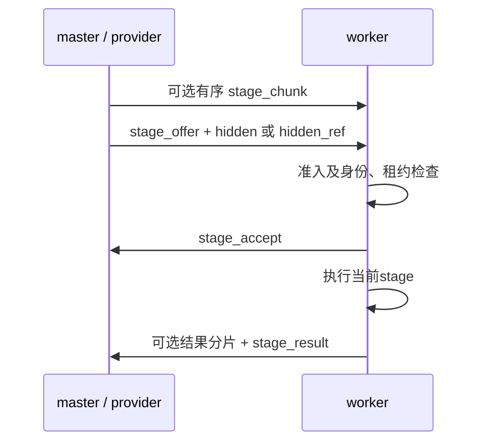

# offer投递时序：实现与验收（2026-10-20）

> 状态：**部分实施**（本机时序、PC及Android JVM开发门通过；设备产品门开放）
> 更新日期：2026-10-20
> 适用范围：21c `COMM-MERGE-01`的现行投递时序、诊断CPU修复、计时合同与复跑证据；设备产品验收归[R6](重构产品验收-R6-2026-10-19.md)。

## 当前投递合同

[RemoteFullWorkerProvider.execute](../src/task_worker_adapter.py)构造的`stage_offer.root_input`已携带hidden，超帧时先发送全部`stage_chunk`，offer再携带`hidden_ref`。PC的[SchedulerTaskWorkerMixin._handle_task_worker_stage_offer](../src/scheduler_task_worker.py)完成准入、发送accept后继续执行；Android的[TaskWorkerClient.handleOffer](../android/app/src/main/java/com/qlh/inference/worker/TaskWorkerClient.kt)在必要的输入装配及accept写入后启动执行协程。master收到accept只解除本地等待，结果沿相同持久连接返回。



worker等待accept的本地写入返回；master对accept的处理可与worker计算重叠。`task_worker_protocol.MESSAGE_TYPES`保持既有集合，新增诊断与安全围栏复用现行wire字段。星状转发、原有binary协商、分片预算、身份匹配、租约、deadline和物理清理继续由原owner负责。后续若改变准入／发送语义，仍需独立协议评审、能力协商和旧路径回退。

## PC诊断与计时

`RemoteFullWorkerProvider.execute`移除诊断参数中的`json.dumps(WorkerMessage, default=str)`；该表达式此前即使debug关闭也会完整遍历offer及hidden，产生的长度还包含对象repr。生产协议的摘要、校验及真正帧编码继续执行。offer日志保留节点、attempt、stage与是否分片字段。

accept与成功result在`handle_message`完成协议、身份及状态校验后，使用同进程`perf_counter`采样并在通知等待者前发布。`tests/test_task_worker_stage_timing.py`固定诊断时钟，覆盖回执早于同步send返回、等待线程尚未运行以及分片准备耗时，验证采样边界。历史日志与缺陷归[问题#70](已知问题记录.md)。

| 日志 | 字段 | 当前区间 |
|---|---|---|
| `perf2` | `a` | offer发送调用前 → accept校验通过并发布 |
| `perf2` | `r` | 上述accept发布 → 成功result校验完成并发布 |
| `perf3` | `p` | provider进入后的本地准备，扣除输入分片函数与offer发送调用 |
| `perf3` | `u` | `_maybe_send_stage_chunks`完整调用，含分片规划、编码与同步发送 |
| `perf3` | `s` | offer发送函数本地调用，含编码、写锁与socket写入 |
| `perf3` | `t` | provider进入 → 成功等待完成后的采样 |

单位均为毫秒；日志使用整数输出，内部保持浮点精度。`s`表示本地发送完成；较快的accept／result可能在该调用返回前已到达。`s`与`a/r`存在重叠，按各自事件边界读取；完整收益比较使用外部包围`execute`的单调时钟。成功请求输出`perf2/perf3`，错误请求继续使用既有具名原因。

## 本机时序与性能证据

复跑工具为[scripts/comm_merge_bench.py](../scripts/comm_merge_bench.py)，测试入口为[tests/test_comm_merge_bench.py](../tests/test_comm_merge_bench.py)。工具运行真实`RemoteFullWorkerProvider.execute`、`SchedulerTaskWorkerMixin`收发／offer处理、`TaskWorkerControlPlane`协商及`TCPClient.send_data/recv_data`；使用同进程双向持久loopback TCP，记录统一`perf_counter_ns`时序。TCP注册、模型／部署准入及executor使用注入fixture；executor校验hidden后返回固定标量。数据范围是provider调用，模型推理和设备生成吞吐另行验收。

原始证据根为`build/comm-merge-20261020/`。`baseline-causal.json`及`candidate-causal.json`各3次把master处理accept延迟80ms，均观察到worker先开始计算；每次master只发送一条offer，完整调用返回相同结果。`*-chunked.json`各3次使用9MiB输入，观察有序分片先于offer，保持同一条调用时序。所有采样记录线程名、消息与attempt身份、事件时间、源码摘要及资源退出状态。

性能A/B在同一Windows主机、Python 3.12.10、debug关闭、计算延迟0下比较修改前后源码。最终比较使用同一工具摘要的r2／r3，先后次序及输入／编码顺序相反；早期开发采样单独保留。每个子进程41条，排除首条预热后每侧合并80条。表中时间为完整`provider.execute`的中位数／样本标准差，单位ms；变化为candidate相对baseline。输入为合成float32 hidden，包含生产摘要、校验、编码、传输与fixture回调成本。

| raw hidden | binary | baseline median / std | candidate median / std | 中位变化 | 两轮方向 |
|---|---|---|---|---|---|
| 16KiB | on | 2.638 / 0.223 | 2.500 / 0.223 | -5.22% | 同向 |
| 256KiB | on | 17.762 / 1.261 | 19.471 / 4.054 | +9.62% | 方向变化 |
| 4MiB | on | 335.576 / 37.463 | 310.652 / 24.339 | -7.43% | 同向 |
| 16KiB | off | 2.623 / 0.194 | 2.529 / 0.244 | -3.59% | 同向 |
| 256KiB | off | 18.319 / 2.028 | 15.799 / 0.724 | -13.76% | 同向 |
| 4MiB | off | 309.439 / 48.598 | 301.658 / 38.317 | -2.51% | 方向变化 |

`performance-comparison.json`保留两轮独立中位数及逐文件摘要，工具摘要固定为`79dfdfe08a8d6c22fd6b84cab7c0abeea450649299b022fec3bde192d87f6b90`。4MiB二进制输入两轮同向改善；小帧和其他条件按表中波动读取。去除诊断CPU工作带来的本机收益，只适用于该测量边界；生成吞吐及设备采用条件继续通过产品门确定。

复跑示例（分别在对应源码下执行baseline／candidate）：

```powershell
.venv-test/Scripts/python.exe -B -X utf8 scripts/comm_merge_bench.py --samples 41 --hidden-size 4MiB --binary on --label candidate --output build/comm-merge-20261020/repeat.json
.venv-test/Scripts/python.exe -B -X utf8 scripts/comm_merge_bench.py --samples 3 --hidden-size 16KiB --master-accept-delay-ms 80 --label candidate --output build/comm-merge-20261020/repeat-causal.json
```

## Android合同与对抗验收

Android启动、终态重复投递及取消收敛的缺陷与现行规则统一登记于[问题#102](已知问题记录.md)。`android-verification.json`及`android-junit/`绑定修改后源码和全量JVM结果：957项通过、4项跳过、0失败／错误；跳过项为原有供应GC链接／junction用例。本票`TaskWorkerSafetyContractTest`的9项及`TaskWorkerClientStateTest`的18项全部通过，含现行wire校验、虚拟时间取消超时、重连重复投递，以及终局写入未返回时下一段执行与旧发送失败的归属保护。

PC合同回归`provider-regression.xml`通过195项，覆盖准入拒绝、精确身份／epoch、重复offer及结果重放、续租与过期、断连、取消交叉与迟到结果、物理停止区分、输入／结果分片及binary兼容。计时用例的修改前失败证据为`timing-red.xml`，旧实现在回执均早于发送返回时得到`a=0 r=0`。 协议、分片、多位置及工具回归另见`wire-tool-regression.xml`／`tool-final.xml`；按各模块最新完整结果去重，`python-verification.json`合计363项通过、0失败／错误／跳过。

## 剩余完成门

- 共同新来源PC／Android产品链在相同工件、线程与网络下采集端到端生成及CPU成本，包含准入拒绝、租约过期、断线重连、取消及迟到结果；同时复验既有21a／21b能力与物理清理。
- Android设备重复投递与长时间native取消必须观察执行计数、停止回执及下一请求，按[问题#102](已知问题记录.md)确认设备行为。
- 若后续时序采证支持改变协议，再以独立能力位和分离模式回退建立新门。

## 已推翻结论

| 历史推断 | 当前依据 |
|---|---|
| 两个`perf2`区间对应两次完整RTT，或对应固定“一次RTT加一次单程” | offer已携带hidden，worker计算与master处理accept可重叠，区间包含编码／调度／准入／计算与接收处理 |
| 通过合并offer与hidden可固定减少每步19ms或38ms | 当前路径已合并投递，收益由完整调用及产品采样确定 |
| 减去假设的往返税即可反推设备每层计算成本 | 设备计算、写入及网络传播需独立事件或相同条件profile |
