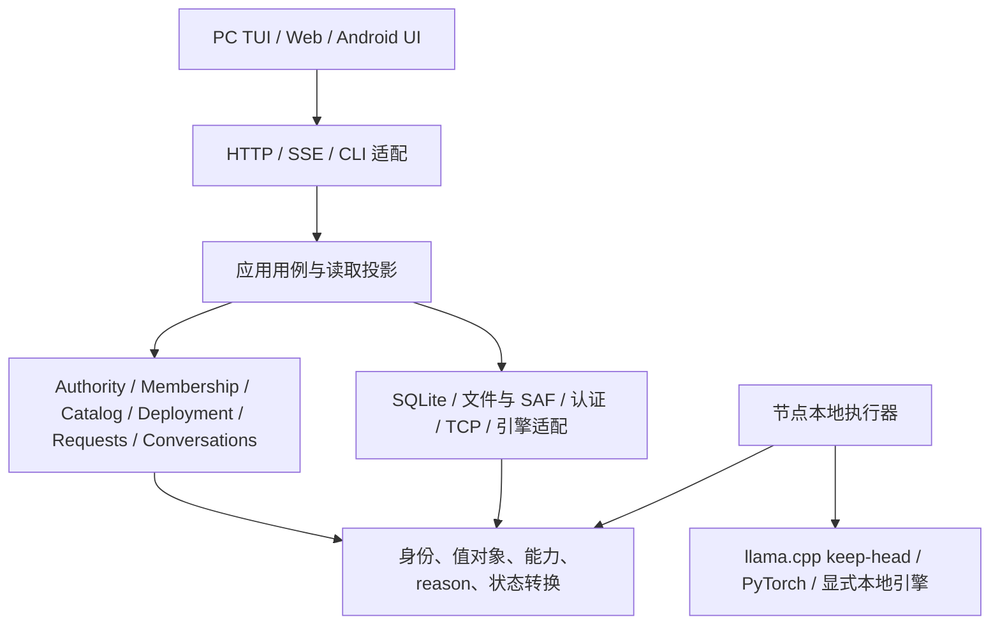

# 单一事实源重构设计（2026-10-18）

> 状态：**部分实施**（R0–R5软件门完成；R6产品门进行中）
> 更新日期：2026-10-20
> 适用范围：独立分支的目标架构、事实归属、状态转换、裁撤次序及验收；当前实现证据只在[功能与事实归属审计](当前功能与事实归属审计-2026-10-18.md)维护。

## 1. 基线与设计决策

基线为 `fb870d1d4ef2d1d2901db1c5e299ac387fc9597b`，分支为 `refactor/ssot-design-20261018`，从干净工作树建立。保留 Git 祖先用于追溯与回退；新设计按明确的产品合同实施，旧私有接口、模块单例、实验路由和测试替身无需成为兼容约束。文中类型、模块和协议名称均为目标设计，实际落地前以各阶段合同测试固定。

重构采用**进程内分域的单体控制面，加节点本地执行器**。先定义每种事实的唯一可写者，再迁移控制流；模块拆分跟随职责。按领域使用小型有类型的命令与回执，跨节点采用持久化命令意图、幂等投递和重连核对。部署事务有明确的发布点和补偿义务，不承诺跨设备瞬时原子提交。

票13按已达到的产品易用性和稳定性范围收口。严格同 clean revision 完整重采、可信签名发行物及各平台实际安装继续作为独立发布前门，结论与原始失败记录见[票13收口](archive/misc/ci-release-followup-2026-10-16.md#14-票13收口与重构基线2026-10-18)。重构期间保持成熟产品行为和安全合同；先完成下述基础阶段，再扩展优化。

## 2. 必须保持的不变量

| 不变量 | 目标约束与检查位置 |
| --- | --- |
| 星状拓扑 | master 唯一编排和转发；worker 只与当前授权 master 交换控制和 hidden，逻辑相邻段只含节点身份；接收端拒绝 worker peer 数据帧 |
| 自动选主 | 角色由同一 authority 服务发布，保留 quorum、term、lease、fence 与续期；发现可达节点仅提供候选地址，写权限必须经过 authority 校验 |
| LL／DL 多段接力 | 连续非空区间完整覆盖 decoder；master 承担首段及 embedding，至少一层；LM head 明确归属且恰好执行一次；跨框架按已验证的模型、tokenizer、hidden 合同准入 |
| 分布式容量价值 | distributed 模式的每个参与节点只物化自己的 proper segment；元数据检查、tokenizer、规划、prepare、失败与重试全程禁止隐式整模加载 |
| 显式本地推理 | 节点可退出计算参与后加载整模；重新参与前必须释放整模并取得新 assignment；用户选择与连接状态、master 角色分别建模 |
| 自动供给体验 | 任一设备提交模型意图；自动规划、裁切／复用／分发、校验、装载、发布、推理；普通用户无需逐台指定层段 |
| 证据与状态对应 | ready 来自精确 deployment／assignment 的实际 runtime 回执；连接失效、进程换代或 lease 失效即时撤销准入；UI 显示其读取版本与未知状态 |
| 可结束且可恢复 | 一次请求只有一个终局；请求总 deadline、执行 lease、心跳时效各自保留语义；迟到结果、取消、重试、清理均有身份与幂等规则 |

`distributed_required` 固定要求至少两个实际计算参与节点。`auto` 在 distributed 模式下容量不足时返回具名等待或拒绝；加载整模须先执行显式模式切换。处于同一网络或仍有控制连接的 standalone 节点可以上报状态，计算资格为关闭。

自动选主保留现有安全机制，并补齐失败检测→重新选举→运行角色转换→客户端重绑定的事件链。当前quorum策略要求至少3个配置voter；voter成员与计算参与节点分别管理，两节点计算不触发随意缩减voter集合。缺少quorum的启动／故障场景明确返回waiting_authority，可采用显式静态master或另设control-only voter；不得以简化为由采用“第一个应答者即有写权”的替代方案。voter集合变更需要独立版本及安全迁移合同。多候选、复制水位和物理分区的生产HA证明仍需独立设备门。

## 3. 功能边界

功能级证据、保留范围与裁撤入口见[审计矩阵](当前功能与事实归属审计-2026-10-18.md#2-功能清单与取舍)。本节只规定新核心的职责。

- 核心：节点身份与选主、参与模式、模型与工件身份、容量规划、自动供给、部署事务、本地执行器、接力推理、上下文、认证、恢复和诊断。
- 优化扩展：n-gram 自投机、原生层段优化、二进制 hidden、分片、标定与放置策略；所有扩展消费同一计划与 runtime 合同。
- 裁撤：PoC 投机解码、通用任务图编排、独立 Launcher；新请求队列采用有界 FIFO，裁撤 MLFQ、SJF 与协同抢占的生产策略及相关专有 UI。
- 后置：hybrid 局部回滚、外部整请求 Provider／TP 孤岛、未闭合的多模态 sidecar。full-attention分布式投机的显式执行面见[21b实现与验收](投机批验证-实现与验收-2026-10-20.md)。保留数据格式、实验资产或窄接口，按证据决定独立启用；主进程启动和默认控制流只依赖核心能力。

任务图将来按实际产品需求重新设计。当前重构只保留接力执行所需的线性 stage 顺序，以及可复用的身份、租约、取消和持久化机制。Launcher 的启动、签名校验和安装职责按 §10 迁移，明确责任后再删除代码。

## 4. 模块边界与依赖方向

新包实际位于 `src/qlh_core/`，避免与根入口 `qlh.py` 同名；下列依赖规则是验收要求。Android 以 Kotlin 实现同一 wire 合同和本地 owner，平台代码按实际生命周期组织。



| 包／边界 | 职责 | 依赖约束 |
| --- | --- | --- |
| `contracts` | 不可变值、校验、状态转换输入输出、wire schema、reason | 使用标准库；导入不触碰磁盘、网络或模型 |
| `control` | authority、成员资格、用户意图、部署和请求 owner | 不导入 UI、FastAPI、torch、native；通过窄端口请求外部动作 |
| `planning` | 根据冻结事实求解放置、预算与合法执行计划 | 纯函数；输出 PlanSpec 或结构化拒绝，不装载权重 |
| `execution` | 串行执行器、stage 顺序、KV 生命周期、采样与判停、取消 | 消费已发布 deployment；禁止自行选节点、读注册表或更换模型 |
| `adapters` | 持久化、路径／SAF、供给传输、TCP、engine、secret store | 实现合同端口；IO 结果作为带身份的回执交给 owner |
| `api`／客户端 | 鉴权、参数翻译、命令提交、投影展示 | 不改领域内部字段；不重算容量、ready、参与节点或失败真因 |
| `bootstrap` | 配置快照、构造依赖、启动与关闭资源、入口分派 | 唯一组合入口；显式实例生命周期，无导入期全局服务 |

独立进程仅服务 native 崩溃隔离、依赖环境或显式本地 server 引擎等现实需要。服务切分和通用事件总线均不作为本阶段目标。跨域调用由应用用例协调，不增加一个包办所有状态的“总调度器”。

## 5. 事实归属

**统一事实源按领域和事实类型划分。** 用户希望执行什么、master 已发布什么、节点现在实际装载什么是不同事实。跨节点信息天然滞后，投影附带来源、版本、有效期和未知原因；过期观测只影响准入，不能被界面或超时线程补成成功。

| 事实 | 唯一可写者 | 持久化／恢复源 | 允许的只读投影 |
| --- | --- | --- | --- |
| 静态运行设置、用户偏好 | `SettingsStore`；启动得到不可变 `RuntimeConfig` | 版本化配置，环境覆盖有明确优先级；运行变更通过命令生成新 revision | 兼容环境变量仅在启动解析一次，模块级 import 值只读 |
| 节点身份、密钥与 epoch | 本地 `IdentityStore`／平台 SecretStore | 原节点 ID 与安全存储；Keystore 临时异常保留密文并具名重试 | 公共 node ID、credential epoch，秘密值不进入公共投影 |
| 当前控制权 | `AuthorityService` | voter 持有的 term、证书、lease、已提交水位 | leader binding、只读角色与拒绝原因；发现缓存无写权 |
| 成员连接与参与资格 | `MembershipService`；本地 `ParticipationController` 写模式意图 | 本地用户模式持久化；连接、心跳和 boot identity 重建 | online、control-only、eligible、freshness；容量仅消费 eligible 快照 |
| 模型修订与跨格式等价证明 | `CatalogService` | 版本化模型元数据和经验证的来源／转换证明 | 展示名、可用格式；路径由节点本地 ArtifactStore 解析 |
| 工件字节与本地可用性 | 各节点 `ArtifactStore` | 实际文件／SAF、manifest、摘要、下载续传日志 | inventory receipt；“已登记”与“已验证可用”分开 |
| 引擎能力 | `EngineRegistry` 定义静态合同，本地 probe 发布实际 availability | 固定引擎／ABI 清单；进程启动重新 probe | 同一 schema 投影为 hello、solver 和 UI 输入 |
| 选模目标及操作状态 | `ModelOperationService` | operation record、revision、deadline、选中指针在同一存储事务提交 | 进度、等待节点、具名失败；supply／deployment 以引用关联 |
| 供给任务 | `SupplyService` | 每个 artifact transfer／cut task 的记录、receipt 与续传日志 | 接收字节、校验阶段、磁盘缺口；供给完成不等于 runtime ready |
| 不可变放置方案 | `Planner` 产出 `PlanSpec`，`PlanRepository` 按内容摘要保存 | 冻结输入版本、model revision、层段、runtime、预算、约束 | 规划解释；状态、ACK 和 mutable reason 放在 deployment 中 |
| 部署、assignment 与发布点 | master `DeploymentService` | deployment、成员 assignment、命令待投递项、cleanup ledger | ready、active 指针、节点回执、retiring；旧字段全部派生 |
| 本地 runtime／KV | 各节点 `RuntimeController` | 活的 native handle／子进程及实际装载回执；崩溃后重新 prepare | runtime receipt；master 保存的是验过的观测，不冒充句柄所有者 |
| 请求、attempt 与终局 | master `RequestService` | admission／attempt／终局，取消与清理义务 | 响应、SSE、metrics 从同一 RequestSnapshot 渲染 |
| 会话上下文 | `ConversationService` | SQLite session／turn／revision；提交按 revision CAS | API／SSE／TUI 读取同一快照，客户端草稿独立保存 |
| 日志、指标、产品证据 | 记录器与独立 observer | 日志、原始回执、真实进程／来源／映射观测 | 排障展示与验收；证据生产器无权限回写运行事实 |

持久化统一使用现有 SQLite 技术栈中的版本化控制库；不可变模型工件和体积较大的观测原件继续存文件。各领域独占自己的表及命令接口。少数跨域原子动作（例如撤销旧选模并设置新目标）由应用用例在明确的存储事务中完成；外部 IO 均在事务外执行。

现有 `WorkerAssignmentRegistry`、`RequestDeadline`、`TerminalOutcomeLatch`、上下文 revision/CAS 已有成熟合同，应迁移或适配。合理分离的持久化与内存缓存、descriptor 与本地路径、心跳与 lease 予以保留；消除的是多处独立写同一真相及读取时修补结果。

## 6. 身份、版本与能力合同

### 6.1 身份各司其职

| 身份 | 绑定内容 | 换代条件 |
| --- | --- | --- |
| `ModelRevision` | 模型谱系、架构／维度、tokenizer／模板修订及跨格式证明 | 源权重、tokenizer 或语义兼容合同改变 |
| `ArtifactRef` | 内容摘要、格式、量化、本段范围、组件、源 ModelRevision | 文件字节或本段选择改变；GGUF 与 Safetensors 各有自己的文件摘要 |
| `NodeIncarnation` | 持久 node ID + 每次进程启动的新 boot ID | 节点进程重启；同一 boot 的重连单独增加 connection generation |
| `AuthorityIdentity`／`AuthorityProof` | 稳定的 cluster ID、voter-set epoch、leader ID、term、lease ID；当前证书／时效作为证明 | 同租约合法续期更新 proof，不使已装载段失效；切主、换租约或撤权使原绑定失效 |
| `PlanId` | canonical PlanSpec 内容摘要 | 冻结的放置、runtime、资源合同或模型修订改变 |
| `DeploymentId`／`AssignmentId` | 一次具体发布及每节点候选 runtime | 重试 prepare／切主重发／重新连接后重新绑定，不复用旧身份 |
| `RequestId`／`AttemptId` | 用户请求、一次冻结执行，绑定 deployment 与上下文 revision | 重试新建 attempt；已流出 token 的请求失败后由用户显式重试 |
| `RuntimeReceipt` | 上述身份、实际层段／组件、engine／ABI、进程实例、loaded bytes、有效状态 | 装卸载、子进程退出或 handle 换代 |

`config_id`、`generation` 等旧字段在迁移入口翻译为明确身份；新核心不再用一个 generation 同时表示选模、连接、模型配置和推理请求。跨框架匹配使用经验证的等价证明和 tokenizer／hidden 合同，不能把不同格式文件 SHA 当作同一个摘要要求相等。

### 6.2 一份能力 schema，多处派生

静态能力键至少表达 `engine family × runtime kind × operation`，并带支持的格式、架构、精度、输入输出、native ABI 与优化约束。动态 probe 只收窄可用集合。`llama.cpp binding/keep-head` 和 `llama-server` 分别声明；后者仅可承接显式本地整模请求，层段准入需要实际 native 合同和 ABI 已验证。

主节点 load resolver、planner、worker hello 和客户端均消费这份 schema。Android 白名单、PC schema 与 capability 编解码使用同一版本化合同 fixture；未报告、过期、未知 ABI 的能力具名拒绝。硬件型号或 `node_type=pc` 无法代替层段能力证明。

每个 assignment 的 `RuntimeLoadSpec` 冻结实际 device、dtype／quant、context、KV、组件与物化策略，纳入 digest。prepared／committed 回执报告实际执行值与物化字节，master 对照准入预算；全局配置或本机探测的后续变化触发新候选，不能改变既有合同。

输入版本分为身份／能力／参与资格等硬revision与资源样本时效。心跳和每次RAM波动只更新观测及有效期，发布前按当前样本重新准入；与模型、runtime或资格无关的观测变化不创建新PlanId，避免永远追不上变化的输入。

`PlanSpec`只含可执行合同和输入版本：层范围、embedding／head 归属、hidden dtype／width、runtime kind、ArtifactRef、context／KV 预算、RAM／VRAM／host staging／磁盘预算及保守余量。诊断输出包含 required、available、reserved、shortfall 与候选排除原因，由 planner 或执行 owner 产生一次，UI 只负责本地化文本。

## 7. 选模与部署事务

### 7.1 操作与部署分别建模

模型操作状态为：

```text
accepted → resolving → waiting_capacity ↔ planning → supplying → preparing → ready
任一未完成状态 → cancelled / failed / superseded
```

`waiting_capacity` 由成员或资源 revision 变化触发重算，并受操作 deadline 约束；一旦 supplying／prepare 发现输入版本失效，撤销候选并创建新 deployment，仍归同一用户操作。`ready` 表示该操作曾成功发布，后续可用性由当前 deployment snapshot 表达；历史操作结果和当前是否能推理分别显示。

部署状态为：

```text
candidate → preparing → prepared → committing → active → retiring → retired
发布前失败 → aborting → aborted
active 失去资格 → invalidated → retiring → retired
```

`active` 是 master 完成发布后的本地事实，`runnable` 是基于当前 authority、成员、runtime receipt 与资源租约的派生准入结果。失效从准入入口立即生效，清理可以随后收敛。清理义务独立保存，终止操作和新建操作均不能抹去它。

### 7.2 发布协议

1. **接收与冻结目标。** 鉴权并以 idempotency key 提交用户意图，CAS更新当前选模指针；旧的未完成操作变为superseded并撤销候选，已ready的历史结果保持，旧deployment单独退休。重试同一 key 返回同一 operation。
2. **规划与供给。** 在一次冻结 Catalog／Membership／Capability／Resource snapshot 上求解；供给按 ArtifactRef 复用、裁切或传输。磁盘／SAF／摘要失败由本地 owner 产生具名回执。供给完成仅证明工件可用。
3. **Prepare。** 持久化候选 deployment 和 command outbox 后发送。worker 校验 authority、boot／connection、精确 ArtifactRef、层段及资格，取得本地执行锁，只加载本段，返回 prepared runtime receipt。
4. **Commit 候选。** master 收齐精确 prepared 回执，重验 authority 与输入版本，持久化 commit 意图；worker 将候选绑定到 deployment，并回 committed。该状态只允许来自授权 master、匹配 deployment 的请求执行。
5. **Publish。** master 收齐本地和远端 committed 回执，在存储事务中 CAS 设置 active deployment 指针；随后开放请求准入。ready 投影引用同一发布 revision。
6. **Retire／Abort。** 发布失败撤销候选；切模先停止旧 deployment 准入、排空或取消执行，再卸载。清理命令有上限等待和重试，只有精确释放回执或独立确认旧进程已结束才消除债务。回执丢失时保持 unknown／cleanup_pending。

网络分区可使个别 worker 保留已 commit 的候选；该 runtime 受 lease 与精确任务身份约束。master 重启或切主先核对持久决策及真实回执，再恢复准入。旧 active 文件、selected 注册项或“曾经 ready”均不足以自动恢复成功状态。

### 7.3 资源不足时的切模政策

默认采用 **retire-before-prepare**，保证设备只需容纳一套 proper segment；保留旧权重会造成新模型装不下时的额外风险。失败后的状态为可恢复的空载／等待并携带真因。只有已验证资源能同时容纳候选时才允许保留旧 runtime 的优化。

需要回到旧模型时，按旧 ArtifactRef 新建一次受同一能力与预算约束的 deployment；这是重新加载的补偿，不承诺卸载后仍可无成本恢复旧 native handle。既有 switch 的用户可见失败和回滚保护须在迁移阶段显式定义测试。

## 8. 节点模式、推理与优化

### 8.1 参与模式

持久用户选择为 `distributed`／`standalone`；过渡过程为 `leaving`／`joining`，实际计算资格由 MembershipService 派生。退出时先关闭准入并撤销 assignment，等待正在执行的任务结束或取消，释放本段后开放整模加载；重入时先卸载整模，再 inventory、probe、prepare。转换失败保留具体阶段和 cleanup_pending，禁止直接把模式文本改成“已完成”。

master 退出计算还须处理控制权：由于 master 首段锚点约束，现有集群 deployment 先失效，再向符合条件的节点转移／重新取得 authority；缺少接管条件则集群等待，当前节点按本地安全清理结果切换。重连和远端推送均不能覆盖持久用户选择。

### 8.2 请求生命周期

应用入口获取 ConversationSnapshot、active deployment 与唯一绝对 RequestDeadline，以有界 FIFO 准入；先保留单 deployment 单执行序列。队列提供容量拒绝、取消、暂停／恢复、位置与等待诊断；pause保留停止接收新请求、存量继续执行的语义；不保留按 token 数分类的 MLFQ、SJF 及中途抢占恢复。

执行器只按冻结的 PlanSpec 顺序推进；master 接收上一段结果、校验后转发下一段。一个 attempt 的模型、assignment、采样策略和上下文 revision 固定。EOS ID、文本停止串与 token 上限由共用 StopPolicy 处理；SSE 在跨 token 停止串尚未判定时保留必要后缀，避免结束标记或下一轮角色文本泄漏。

每次状态推进都验证 authority、deployment、assignment、node incarnation、connection generation、attempt 和 step。已处理消息按身份／摘要幂等；冲突副本拒绝。取消、超时与完成竞争由owner的终局CAS／latch决定，随后只追加次要诊断。请求terminal与执行资源draining／stopped分别记录；cancel ACK或释放本地reservation不足以释放native执行槽，只有实际停止证据及KV清理后可复用。重试创建新 AttemptId，清理旧 KV 与 lease；跨进程重启默认结束未完成的生成，不推断重建旧 KV。

成功回复的 turn 以会话 revision CAS 落库；客户端断开、取消和部分输出保留独立记录，不能作为成功 turn 回灌。多客户端的active session属于各自会话选择，不再由一个服务端全局session ID隐式决定所有请求。Android Room的离线会话／消息和工作台的sessions／RAG／memory是各自的用户数据域，保留本地owner与稳定ID；服务端上下文按明确session映射读取，未实现的跨端历史同步单列后置，不能通过“统一状态”清空本地数据或假定它们已经与master同步。

### 8.3 自投机与原生优化

`RuntimeAdapter.forward(batch, state, output_mode, context)`明确输出hidden／last_argmax／argmax_seq，统一携带位置、序列与RuntimeLoadSpec。当前标量argmax基线按greedy验收；默认分布式请求在准入前明确greedy策略，历史API采样默认值的迁移保持普通接力流程可用。显式随机采样需独立概率或完整logits及采样状态合同，未具备时具名拒绝，不能接收参数后静默忽略。`StateAdapter`分别声明checkpoint／fork、commit_prefix、discard能力，覆盖KV和recurrent状态；缺少能力时拒绝对应优化。

`OptimizationPolicy`声明作用范围（standalone／segment）、算法、预算、native ABI、所需能力及回退策略。新策略须明确对 runtime 状态的所有权，关闭优化使用相同的执行与判停合同。

- 保留已有standalone binding／server的n-gram自投机，在各自已验证路径启用；其收益范围按现有证据登记。MTP、KV类型、Flash等设置以requested→admitted→effective及原因表达，runtime未接线的选项具名拒绝／显示未生效。
- 分布式投机独立于PoC解码入口，消费相同冻结计划和请求owner；full-attention的显式执行面及状态恢复合同见[21b实现与验收](投机批验证-实现与验收-2026-10-20.md)。γ=1保留基线，hybrid单列recurrent状态恢复验收；通信探针与实际提交吞吐分别计量。
- `COMM-MULTIPOS-01` 只补输出能力，不能替代 draft、回滚或多序列并发。一次推多个位置与多个请求同时在飞分别验收。
- 二进制 hidden、帧预算与分片保留；协议优化只能更改传输方式，不能削弱准入、lease、取消或身份校验。
- `LLAMA-UPSTREAM-DEP-01` 的 ABI／补丁治理前置于原生引擎扩展；ISA、kernel 或量化变化均重新执行对应的数值门。

## 9. 持久化、恢复与可观测性

1. **本地提交。** owner 的状态 revision、待投递 command 和必要审计事件在一个 SQLite 事务提交；发送在事务外。重复投递由接收端幂等处理。事件用于审计及有限恢复，先保持小型命令日志，不引入全系统事件溯源框架。
2. **重启。** 进程创建新 boot ID，native readiness 从 unknown 开始；重放未结清的 commit／abort／retire 义务，重新观测，验证 authority 后重新发布。持久 desired intent 可触发新部署，旧 ready 无法直接恢复。
3. **控制权切换。** authority 先以无副作用步骤验证证书真实性、有效期、term 和恢复域清单，再向 recovery owner 授予一次性恢复许可，完成追赶／必要截断后才激活写权。voter ledger 持久保存每个恢复域的 committed floor，续租和切主提议必须覆盖并保持它，删除依靠显式 tombstone；读取失败不能缩减承诺集合。移除 task graph 后，operation／deployment／cleanup 与 request journal 均有独立恢复域及提交语义，旧 workflow 水位只证明旧图域。单机SQLite原子性与跨主多数提交分别标注，未复制到多数的记录不能宣称HA已提交。
4. **并发。** 每个 owner 的状态转换在短锁或串行命令队列内提交；网络、摘要、裁切和模型加载在锁外执行，再按 revision 校验回执。组合入口按依赖逆序关闭资源，关闭有截止时间并保留未完成清理事实。
5. **快照。** 对外 Operation／Deployment／Request snapshot 包含 revision、来源身份、observed_at、validity 与 reason；跨 owner 聚合通过 revision 校验得到一致读取，变化期间返回 pending／retry。GET 保持只读，不借查询触发加载、重排或修补状态。
6. **reason。** 共用 Reason 结构为 `domain/code/source/retryability/details/cause`；同一语义 code 只定义一次，领域不同的失败可共享 cause。UI 本地化消费 code＋details，完整 cause 原样保留；不再从错误字符串中解析 readiness。
7. **证据。** 产品来源、PID／创建时间、native 映射、实际选层、星状连接和回执独立观察保持；严格门与产品成功分别记录。source-only 诊断保持空载可用，runtime 诊断需要真实模型观测。

## 10. 裁撤与数据迁移

### 10.1 裁撤前迁移职责

| 裁撤项 | 必须先接住的职责 | 具体边界 |
| --- | --- | --- |
| PoC 投机解码 | 如有共用统计／sampler，提取纯 helper；保留独立数值测试资产 | 移除 experimental 入口和配置、TUI专有入口、生产导入；保留已验证 n-gram 适配 |
| 任务图／workflow | stage offer／cancel／result、assignment、lease／fence、单终局、持久化与复制水位 | 接力不再构造通用Workflow／TaskGraph；`task_provider`类型、`TaskGraphError`、`active_task_graph_model_identity`的共用职责迁至执行／身份合同；API与EngineHost两组合入口同步清理。`graph_orchestrator`的放置图另由纯planner替代 |
| MLFQ／SJF／抢占 | 有界等待、admission、FIFO、deadline、取消、结果回收与队列投影 | 删除专有层级、aging、抢占 KV 快照和 UI 配置；不要求新执行器模拟旧内部队列 |
| 独立 Launcher | 正式程序首启、配置、Tailscale引导、服务／TUI分派；安全分离的安装与签名检查 | R5已由冻结`launcher.py`薄入口和`src/app_bootstrap.py`承接应用首启，`app_maintenance.py`与`slim_entry.py`承接维护和Slim；保留helper最早分派、应用原子更新／回退和保数据合同，交付见R5报告 |
| 旧 scheduler／API 门面 | 外部产品入口、鉴权、上下文／错误合同的必要适配 | 路由只做适配；删除反向读取模块变量、私有 monkeypatch 接点和 facade 状态采纳 |

后续删除／移动先生成 dry-run：文件与符号、引用消费者、配置、测试、构建 spec、APK／前端与文档影响清单。实验件按仓库规则先归档至本机 `_archive/`；交付文档走 `docs/archive/`。R0新增合同fixture、行为复现与静态门，实际代码裁撤按依赖迁移后实施。

### 10.2 用户数据迁移

迁移程序提供 `--dry-run`、版本检测、影响清单、空间估计和一次性导入报告。原 state 先备份，新控制库使用独立 schema／路径；旧程序回退使用原备份，避免两个版本同时写同一 state。

- 保留节点 ID、安全凭据及 epoch、会话内容和用户偏好。Android SAF grant 以系统持久授权为准，迁移只保留 URI 与校验信息；授权异常报告具体状态。
- 模型目录和大工件零复制优先：导入可验证的 ArtifactRef／本地位置，精确校验并重新登记；失效 legacy 元数据只影响对应候选，不让它覆盖已验证工件。
- 旧 active plan、selected 指针、native ready、connection、KV 与 lease 仅作为恢复线索，必须重新观测与发布。
- 旧未完成请求具名结束；清理债务逐项导入并先核对。遇到未知 schema、损坏凭据或无法辨认的未结清 runtime 时停止迁移并保留原件。
- 当前打包、Android 与前端是各自独立 Git 子模块；改动记录对应 SHA 与合同版本，不将主仓 HEAD 当作所有端的唯一来源。

## 11. 分期排票与完成门

下列是票14的实施子阶段；R0软件门已完成，具体资产、缺陷复现和验证见[R0合同基线](重构合同与行为基线-R0-2026-10-18.md)，R1交付与当前验收范围见[R1启动与控制权](重构启动与控制权-R1-2026-10-18.md)，R2目录、工件、能力与纯规划的软件交付见[R2模型目录与能力](重构模型目录与能力-R2-2026-10-18.md)。R3事务、清理债务与恢复域交付见[R3供给与部署](重构供给与部署-R3-2026-10-18.md)，R4冻结线性执行、runtime owner与请求恢复域交付见[R4接力执行](重构接力执行-R4-2026-10-18.md)，R5版本化客户端、职责裁撤、显式迁移与软件证据见[R5客户端切换](重构客户端切换-R5-2026-10-19.md)。各阶段先有可检查的合同与依赖，再替换 owner。每次迁移一个聚合的读写，旧兼容门面只代理到新 owner；同一聚合禁止新旧两套写入。

| 阶段／票 | 可审阅交付与完成条件 | 前置 |
| --- | --- | --- |
| R0 `REFACTOR-CONTRACT-01`（软件门完成） | 固定外部产品合同与不变量；为注册竞争、host镜像分叉、prepare策略漂移、续租误失效、水位退缩、验签前副作用及采样参数静默忽略建立行为用例；新增 architecture import/write 边界门；区分行为测试和旧结构 characterization；发布需迁移／裁撤的入口清单 | 本设计及审计 |
| R1 `REFACTOR-BOOTSTRAP-01`（软件门完成） | 显式 AppRuntime 构造／关闭、不可变配置、IdentityStore、authority 与 participation 接口；authority验证先于恢复副作用、稳定租约身份与续期proof分离；import 零资源启动；隔离测试能构造两个独立 runtime；首启／native 子进程替代职责确定 | R0 |
| R2 `REFACTOR-CATALOG-01`（软件门完成） | 单一 CatalogService及ModelRevision／ArtifactRef／EngineRegistry；目录全入口CAS、加载前工件验证、旧注册表dry-run／导入、SAF端口与磁盘inventory；PC／Android capability fixture一致；solver纯输入／输出且预算同源；逐assignment强制spec与实际回执由R3接续 | R1 |
| R3 `REFACTOR-DEPLOYMENT-01`（软件门完成） | ModelOperation／Supply／Deployment owner、持久命令与清理债务；模型控制恢复域与图域解耦、committed floor不退缩；prepare／commit／publish／retire；重连换代、旧 ACK、磁盘失败和崩溃恢复矩阵通过 | R2 |
| R4 `REFACTOR-EXECUTION-01`（软件门完成） | 独立线性接力执行器、本地 runtime owner、FIFO、唯一 deadline／终局／StopPolicy；LL／DL、采样能力准入、取消、上下文 CAS、无隐式整模通过；摆脱 Workflow 与抢占依赖 | R3 |
| R5 `REFACTOR-CLIENT-CUTOVER-01`（软件门完成） | API／SSE／TUI／Android 消费版本化快照；选模、模式切换、进度与真因一致；移除任务图、PoC、MLFQ 与独立 Launcher；依赖／配置／构建／帮助和旧测试同步清理 | R4；客户端合同工作可自 R0 并行 |
| R6 `REFACTOR-PRODUCT-GATE-01`（进行中，[设备证据](重构产品验收-R6-2026-10-19.md)） | 新包实际首启与数据迁移；9B 自动 LL／DL 多节点接力、节点数量变化、掉线／取消／重入；无整模独立观测；完成事实源和裁撤复核 | R5 |

R0对已确认缺陷采用具名的旧实现复现用例或strict xfail，注明负责阶段与撤销条件；正确目标合同单独断言，不能将错误行为冻结成新架构必须兼容的规则。

关键依赖为`R0 → R1 → R2 → R3 → R4 → R5 → R6`。R0固定 wire 合同后，可并行开发 Android 编解码、纯 planner、native ABI 测试及客户端快照消费者；各 owner 的唯一写入与发布顺序按主线串行集成。R3／R4 前不得先以新 UI 包装旧多状态聚合并称为重构完成。

原票19的 metadata／标定实现作为 R2／R6 输入，剩余设备项按真实窗口安排。票21各子票的开发门、设备门与收益门由[状态索引](彻查后修复与重构排票计划-2026-10-09.md#票-21pipe-comm-01-层流水线通信开销削减p1三阶段)统一登记；总票保持部分实施，共同新来源设备采证沿R6逐项闭合。票21a已接入的二进制帧作为 R4传输基础保留；剩余新旧能力对拍及收益验收继续登记。票22a的依赖／ABI治理并入 R2／R4 前置，22d的构建与数值门贯穿执行器验收。票21b-0的新能力／输出合同及本机原生开发门见[实现与验收](末段多位置argmax-实现与验收-2026-10-20.md)，21b的full-attention生产接线及验收见[21b实现与验收](投机批验证-实现与验收-2026-10-20.md)，21c的投递时序、开发门与产品完成门见[21c实现与验收](offer投递时序-实现与验收-2026-10-20.md)；22b的候选评估、本机数值拒绝与重开条件见[22b评估与验收](22b-CPU内核候选-评估与验收-2026-10-20.md)，本轮不准入新增kernel；22c／22e按新扩展边界评估价值，不沿用“19直到22全部完成才审14”的旧顺序。

## 12. 验收与退出标准

### 12.1 软件门

- 纯合同／状态转换：合法转换、幂等、冲突副本、stale revision、重复取消、终局竞争与 reason 透传；领域导入无 IO。
- 组合与生命周期：health可响应与`/api/ready`可调度分别验证；自建后端负责收尾、复用后端不误停；无业务依赖时仍可verify／离线diagnose，检查命令不隐式pip或移动数据；独立临时state、两个 runtime 的实例隔离、冷启动、关闭、journal 独占、子进程不继承错误配置；串行及既有 xdist 组合均通过。
- 故障矩阵：供给后／prepare 前、prepared 后／commit 前、部分 commit、publish 前后、cancel／retire 中的崩溃；丢 ACK、旧 boot／connection／term、磁盘满、SAF 失效、native crash、清理超时。
- 数值与协议：冻结模型／量化／构建的逐 token argmax 对拍；LL／DL分别验，greedy输出与随机采样能力准入分别验，EOS和跨token文本判停；PC／Android schema、二进制预算与分片、无peer路径。
- 产品合同：普通 API 与 SSE 同一状态／终局和会话；新入口兼容性差异有显式清单；裁撤端点退出后，旧实验请求返回明确的移除／版本错误。
- 结构门：每类事实唯一可写者、查询无副作用、UI／planner不写runtime、executor不选模型／节点、核心不导入裁撤模块；兼容层有阶段终点并在 R5移除。

现有 `test_refactor_characterization_baseline.py` 中对“两张表”“多份常量”“门面镜像”的断言是旧结构定位证据，按对应阶段显式改为收敛后的断言。`test_refactor_largefile_baseline.py` 中导出名、mixin 与私有 monkeypatch 接点按外部合同需要取舍；用固定版本的 OpenAPI／请求样例验证产品，避免以运行时 HEAD 作为不断移动的唯一基准。

### 12.2 设备门

至少两档：两节点与三节点，含 PC-only 变化及 Android 参与；以 Qwen3.5-9B 或同等容量价值模型，从正常产品入口自动完成 LL／DL，记录实际节点、range、engine、物化字节、星状连接、正常停止及 fallback=false。基线事实引用票13报告，性能比较须使用同一模型、量化、构建、采样与重复测量。

覆盖：单处选模／无手填层段、无预置段供给、断线重连、取消后的下一请求、显式本地退出／重新参与、切模后无旧映射／显存残留、SAF及磁盘空间失败可恢复。自动选主需单列角色收敛与旧master fencing；完整物理HA与可信签名发行门按独立报告说明完成或未执行。

设备窗口缺失时，软件阶段可独立交付，R6明确保持未验。R0按软件合同验收，后续真实产品行为由R6另采。

### 12.3 重构完成

完成意味着：同一事实只有一个可写入口、不可变计划与实际runtime关联清楚、事务发布与清理可重建、裁撤项退出核心和正式包、普通用户流程保持自动化、9B LL／DL容量价值与星状证据保持。源码行数减少或大文件拆散只是结果指标。

中途回退以整个可运行版本和独立state备份为单位；进入新owner后的聚合不再回写旧状态库。R6前允许稳定基线继续作为设备运行版本，重构分支独立构建与验证。
