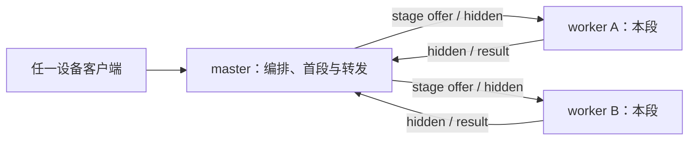

# 项目总览与整体架构

> 状态：**现行**
> 更新日期：2026-10-28
> 适用范围：当前产品执行路径、分层与节点职责。源码功能及风险详见[审计清单](当前功能与事实归属审计-2026-10-18.md)，新分支目标架构详见[重构设计](单一事实源重构设计-2026-10-18.md)。

## 1. 产品目标与当前基线

QLH使多台异构PC和Android设备通过层段接力运行单机容量受限的模型。用户在一台设备选模，master统一规划、供给和准备；各计算节点只加载自己的连续层段，通过master完成逻辑多段接力。

当前发行合同为[release-contract.json](../release-contract.json)`route-a-production-v1`，开启A3 `stage_offer_v3`。2026-10-18已在Windows免安装程序及Android参与的Qwen3.5-9B三机LL／DL实测中完成自动供给、正常判停和无fallback；准确层段、来源与独立装载观测见[票13实测](archive/misc/ci-release-followup-2026-10-16.md#13-rog-免安装续验与-frozen-来源合同2026-10-18)。票13产品验收已收口，完整严格重采与可信签名发行实际执行独立后置。

## 2. 当前执行路径

| 路径 | 引擎与实际职责 | 边界 |
| --- | --- | --- |
| LL层段接力 | master llama.cpp首段→各worker llama.cpp后续段；master转发所有hidden | 正式分布式路径，proper GGUF、keep-head／native前向；所有节点仅加载本段 |
| DL跨框架接力 | master PyTorch选择性物化首段→llama.cpp worker后续段 | 正式分布式路径；校验源模型／tokenizer等价证明及hidden合同 |
| 显式本地推理 | 节点退出计算参与、退休层段后，选择本地完整模型引擎 | 允许整模基线；重新参与前卸载整模；`_set_node_inference_mode`控制转换 |
| 本地llama.cpp runtime分流 | binding／keep-head提供层段能力；llama-server用于其已验证的本地完整模型路径 | `inference_path_selector.select_inference_path`裁决，不能把server当层段执行器 |
| external／island | 外部整请求服务或单个逻辑网关引擎 | 可选扩展、独立数据作用域与fallback观测；不计作本仓LL／DL多段成功 |
| 专用sidecar | 模型专用runtime | 独立扩展单独评估；通用任务图与独立投机PoC已按R5裁撤 |

本地n-gram自投机与层段执行能力分别建账。二进制hidden和分片已接入task-worker传输；分布式投机批验证仍缺draft和hybrid回滚等前置。实现状态及符号以[审计矩阵](当前功能与事实归属审计-2026-10-18.md#2-功能清单与取舍)为准。

## 3. 星状物理拓扑与逻辑接力

逻辑顺序为首段→中间段→末段，物理连接始终通过master。层段数量根据实际能力和容量求解；节点ID只表示身份，worker不接收peer地址以建立层数据直连。master至少执行首段一层并承担embedding；LM head在计划中明确归属。

master统一验证task、attempt、model、config、assignment、连接代际、step和相邻段关系。已发布部署的实际入口为[bootstrap/execution.py](../src/qlh_core/bootstrap/execution.py)`ExecutionApplication.run`与[linear.py](../src/qlh_core/execution/linear.py)`LinearExecutor.run`，调度入口[scheduler_pipeline.py](../src/scheduler_pipeline.py)`run_pipeline_safe`委托该应用服务，远端准备为[worker_prepare_coordinator.py](../src/worker_prepare_coordinator.py)。库存、HELLO及文件available只证明对应阶段；ready需要当前assignment实际装载回执。

## 4. 当前实现分层

| 层 | 主要实现 | 实际职责与结构边界 |
| --- | --- | --- |
| PC客户端／管理 | `qlh.py`、`tui_textual.py`、`tui_commands.py`、`tui_api.py` | 选模、聊天、进度与状态；不应自行决定集群ready |
| Android／Web | Android Full／Lite、`frontend_cybergothic`子模块 | Full本机计算与UI、Lite客户端；Room／DataStore仍有各自用户数据和本地设置 |
| API与应用门面 | `api_server.py`、`api/routes_*.py` | HTTP／SSE适配、机器身份/来源检查与服务组合；版本化客户端投影由应用服务提供 |
| 意图／供给 | `model_intent.py`、`model_supply.py`、`model_supply_worker.py`、`model_supply_assets.py` | 目标模型、inventory、裁切／分发、校验、进度与供给回执 |
| 放置／调度 | `qlh_core/planning`、`qlh_core/control/deployment.py`、`scheduler.py`及mixin | 纯容量求解与部署owner；旧入口适配和节点事件保留在scheduler |
| 准备与执行 | `qlh_core/execution`、`qlh_core/bootstrap/execution.py`、`worker_prepare.py`、`model_host.py`、`inference_service/engine_host.py` | 冻结线性计划、FIFO及请求终局；native owner与KV排空；候选装载、commit及物理退休 |
| 引擎 | `llama_engine.py`、`llama_keep_head.py`／shim、`model_module.py`、`llama_server_engine.py` | proper层段或显式本地完整模型；按runtime能力选择 |
| 通信与控制权 | `tcp_comm.py`、`task_worker_protocol.py`、节点配置与注册模块 | 静态角色、星状传输、机器注册和连接恢复；节点发现与重连不改变角色 |
| 存储／证据 | `local_store.py`、`recovery_journal.py`、`qlh_core/adapters`、runtime source／product observer | 模型控制与请求各自本地事务、历史恢复域及独立来源观测 |
| 启动／打包 | `src/app_bootstrap.py`、`packaging/packaging/launcher.py`、`app_maintenance.py`及正式spec | bootstrap承接首启、helper及API／TUI；签名应用维护由CLI提供，独立Launcher壳已裁撤 |

源码功能清单也包括独立工作台的工具、摘要、RAG、记忆和生图扩展；这些有自己的用户数据及入口，不等于已接入主聊天或分布式核心。

## 5. 静态角色、模式与恢复

集群恰有一个显式配置的静态 master，其余节点为 client；client 可发现并重新连接配置的 master，但不晋升。master 故障时没有自动接管，恢复依赖原 master 上线或运维在旧 master 停止后手动迁移角色。自动选举、quorum voter、备用主节点、角色转让/审查已退出支持运行时。部署与迁移规则见[静态主节点决策](静态主节点部署与认证退役决策-2026-10-27.md)。

计算资格、控制可达、用户模式和模型驻留分别描述。节点显式本地模式可以保留管理HTTP或绑定信息；分布式执行期间任何节点的加载、prepare、失败补救均须遵守整模禁载。本地模型控制与请求记录分别由`SqliteModelControlRepository`和`SqliteRequestRepository`原子提交；重启保留清理义务并重新观测ready。`JournalPrefixAuthority`分别核对`model-control:v1`与`requests:v1`恢复域；产品运行时采用单一静态 master，不提供跨主多数复制或自动接管。

现有assignment registry、请求deadline／终局latch、会话revision/CAS、安全凭据epoch与路径防护是保留合同。真实源字节／进程观测与可信签名发行分别验收，`/api/health`与`/api/ready`分别表示可响应和运行时就绪。

## 6. 重构入口

独立分支`refactor/ssot-design-20261018`起于`fb870d1d`。当前已建立审计、目标设计及[R0合同与行为门](重构合同与行为基线-R0-2026-10-18.md)，R1已接入显式runtime、身份配置与authority owner，具体交付及兼容边界见[R1启动与控制权](重构启动与控制权-R1-2026-10-18.md)。R2已接入目录CAS、工件加载校验、统一能力与纯容量规划，交付及验收见[R2模型目录与能力](重构模型目录与能力-R2-2026-10-18.md)；R3已接入模型控制事务、冻结规格和实际回执、持久命令与清理恢复，交付及验收见[R3供给与部署](重构供给与部署-R3-2026-10-18.md)；R4线性执行、native owner、请求恢复域与软件验收见[R4接力执行](重构接力执行-R4-2026-10-18.md)；R5版本化客户端、迁移、职责裁撤及软件证据见[客户端切换](重构客户端切换-R5-2026-10-19.md)。R6已于2026-10-19实施并出具[产品验收报告](重构产品验收-R6-2026-10-19.md)：新包实际首启、正式数据迁移及多设备9B LL／DL均已取得证据，剩余设备与收益门按其§7登记；2026-10-25起执行重心为[PERF系列性能票](异构推理吞吐瓶颈与外部技术调研-2026-10-24.md#6-实验排期与退出判据)。设计以领域唯一可写owner、不可变计划、runtime实际回执、发布点与清理义务为中心；功能裁撤和阶段依赖见[单一事实源重构设计](单一事实源重构设计-2026-10-18.md)，执行状态索引见[排票计划](彻查后修复与重构排票计划-2026-10-09.md)。
